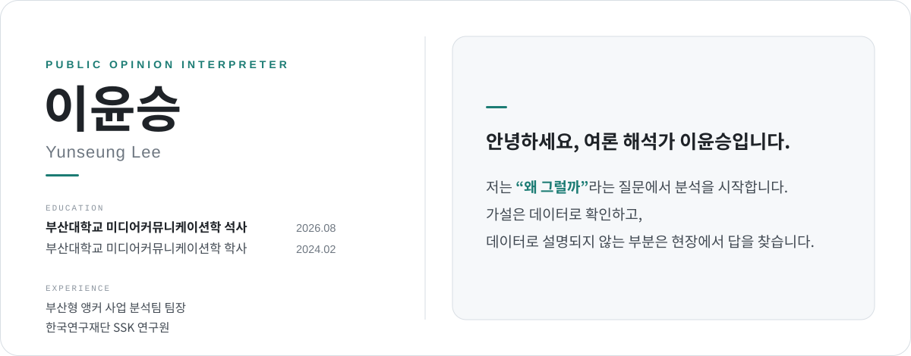
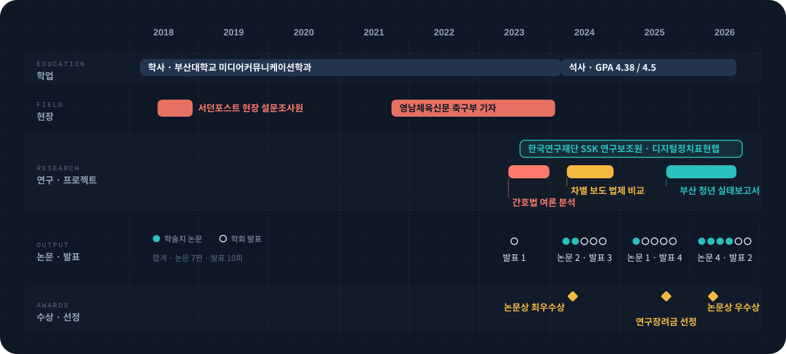
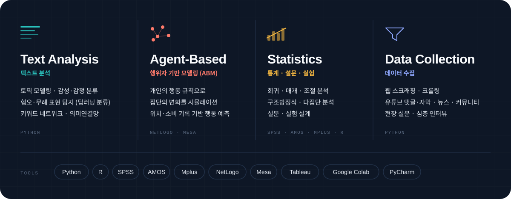

 

## Profile

 

## Timeline

 

## Toolkit

 

## Analytical Approach

현상에 대한 "Why"에 답하기 위해, 저는 데이터를 쪼개고, 합치고, 필요하면 현장에서 새로 모읍니다.

 

## Featured Projects

여론 해석가로서 일하는 방식이 가장 잘 드러나는 세 가지 프로젝트입니다. 
제목을 누르시면 분석 과정과 결과를 정리한 상세 페이지로 이동합니다.

 

### 01 &nbsp; 언론은 부산 청년·유학생이 실제로 겪는 문제를 그만큼 다루고 있을까? &nbsp;`2025.09 – 2026.08`

**부산형 앵커(ANCHOR) 사업 · 빅데이터 분석팀 팀장** &nbsp; `Python` `BERTopic` `감성 분석` `시계열 분석` `상관분석` `KOSIS` `PCA` `의미연결망`

> 청년 통계와 지역 언론 기사를 같은 의제 기준으로 맞대어, 통계가 보여 주는 청년의 현실과 언론이 다루는 청년 문제 사이의 간극을 찾았습니다. 보고서의 양식, 분석 방법, 결과 작성을 맡았습니다.

- 2026 성과 보고회 발표 예정 &nbsp;·&nbsp; [관련 기사](https://channelpnu.pusan.ac.kr/news/articleView.html?idxno=39507) &nbsp;·&nbsp; [**상세 분석 보기 →**](projects/anchor-busan-youth.md)

 

### 02 &nbsp;유튜브에 콘텐츠의 유형에 따라 이용자들의 반응 비교 &nbsp;`2024.05 – 2025.12`

**『사회과학연구』 32권4호 제1저자** &nbsp; `Python` `K-means` `Kruskal-Wallis` `내용분석`

> 제22대 총선 부산 후보 35명이 선거 기간에 올린 유튜브 콘텐츠 376건을 분석했습니다. 콘텐츠 하나에도 공약 설명, 유세 현장, 방송 장면이 섞여 있는 경우가 많아, 한 유형으로 딱 구분하기 어려웠습니다. 그래서 영상마다 12개 내용이 각각 차지하는 시간 비중을 잰 뒤, 비중이 비슷한 콘텐츠끼리 군집화로 묶어 5개 유형을 만들고 유형별로 조회수·댓글·좋아요를 비교했습니다.

- 2024 한국언론학회 가을철 정기학술대회 발표 &nbsp;·&nbsp; [DOI](https://doi.org/10.46415/jss.2025.12.32.4.537) &nbsp;·&nbsp; [**상세 분석 보기 →**](projects/politician-youtube-campaign.md)

 

### 03 &nbsp;간호법은 언론과 커뮤니티에서 어떻게 다루어졌는가? &nbsp;`2023.06 – 2023.12`

**대한간호협회 의뢰 프로젝트 수행 (데이터 수집 · 분석 · 보고서 결과 기술)** &nbsp; `Python` `LDA` `의미연결망` `딥러닝 감성 분석` `비시민성 분석` `웹 스크래이핑`

> 2023년 간호법 제정 논쟁 때, 대한간호협회의 의뢰로 언론 보도와 온라인 여론을 분석했습니다. 정해진 분석 틀이 없어, 매 단계의 결과를 보고 다음 분석을 정하는 상향식(Bottom-up) 접근 방법으로 진행했습니다. 언론 보도는 토픽 모델링으로 의제를 나눈 뒤 시계열 분석과 의미연결망 분석으로 의제의 흐름과 연결 구조를 살폈고, 여론은 커뮤니티 게시글과 협회 유튜브 댓글의 감성과 비시민성을 비교했습니다.

- 대한간호협회 성과 보고회 발표 &nbsp;·&nbsp; [**상세 분석 보기 →**](projects/nursing-law.md)

 

## Publications

제목을 누르면 논문을 보실 수 있는 페이지로 이동합니다.

### Journal Articles

**2026**

- **[The relationship between political YouTube news use and affective polarization in election vs. non-election contexts: mediation by hostile expression and moderation by political rumor acceptance](https://doi.org/10.1177/1329878X261494415)** 
  *Media International Australia* &nbsp;·&nbsp; Kim, B., Lin H., **Lee, Y.**, & Lee, J.

- **[The Interplay of Agenda Building and Agenda Setting across Policy, Media, and Public Agendas](https://doi.org/10.1177/10776990261416905)** 
  *Journalism & Mass Communication Quarterly* &nbsp;·&nbsp; Lee, J., **Lee, Y.**, & Kim, B.

- **[Does YouTube Shape Conspiracy Mentality? A Three-Way Interaction Effect of Partisan YouTube Channel Use, Like-Minded Discussion, and Interest in Politics](https://doi.org/10.1080/1369118X.2026.2653097)** 
  *Information, Communication & Society* &nbsp;·&nbsp; Li, X., **Lee, Y.**, & Kim, B.

- **[The Relationship between Political YouTube News Use and Affective Polarization in Election vs. Non-Election Contexts: Mediation by Hostile Expression and Moderation by Political Rumor Acceptance](https://doi.org/10.1177/1329878X261494415)** 
  *Media International Australia* &nbsp;·&nbsp; Kim, B., Lin, H., **Lee, Y.**, & Lee, J.

- **[How News-Finds-Me Perception Relates to Affective Polarization: User-Centric News Evaluation and Political Figure-Centered Talk as Mediating Mechanisms](https://doi.org/10.1108/OIR-04-2025-0223)** 
  *Online Information Review* &nbsp;·&nbsp; Li, X., **Lee, Y.**, & Kim, B.

**2025**

- **[정치인 유튜브 선거 캠페인 콘텐츠의 소구와 이용자 참여](https://doi.org/10.46415/jss.2025.12.32.4.537)** &nbsp;제1저자 
  『사회과학연구』, 32(4) &nbsp;·&nbsp; **이윤승**, 리시웨, 김범수 &nbsp;·&nbsp; [분석 정리](projects/politician-youtube-campaign.md)

- **[News-Driven Discourse and Support for Democratic Norms: Examining Political Knowledge and Tolerance as Moderators](https://doi.org/10.1080/08838151.2025.2498431)** 
  *Journal of Broadcasting & Electronic Media*, 69(3) &nbsp;·&nbsp; Kim, B., Li, X., & **Lee, Y.**

**2024**

- **[Examining Civic Engagement Processes for a National Event: The Moderating Role of YouTube Content](https://www.dbpia.co.kr/journal/articleDetail?nodeId=NODE11812117)** 
  『사회과학연구』, 31(2) &nbsp;·&nbsp; 리시웨, **이윤승**, 김범수

### Conference Presentations

- **ICA 2026**, Cape Town — To Be More Homogeneous? Effects of News-Related Distress and News Customization on Online Homophily
- **AEJMC 2025**, San Francisco — Multi-Group Analysis of Political YouTube Channel-Based News Use, Negativity, and Affective Polarization 제1저자 · 포스터
- **ICA 2025**, Denver — Does YouTube Shape Conspiracy Mentality?
- **ICA 2024**, Gold Coast — Cognitive and Affective Consequences from the News-Finds-Me Perception

국내 학회 발표 6건

 

- **한국언론학회 2026 봄**, 여수 — 대통령 선거 기간 한국 신문 사설의 도덕 기반과 논조 구성 제1저자
- **한국소통학회 2025 봄**, 군산 — 사용후 핵연료 관련 뉴스 담론 분석: 2023년 8월 – 2025년 3월
- **한국방송학회 2025 봄**, 전주 — Issue-keyword network associations between hyper-partisan YouTube channels, online communities and media
- **한국언론학회 2024 가을**, 공주 — 정치인 유튜브 선거 캠페인 콘텐츠의 소구 유형과 이용자 참여 단독
- **한국언론학회 2024 봄**, 경주 — 뉴스 기반 담론과 민주적 규범 지지: 정치 지식과 관용의 조절 효과
- **한국PR학회 2023 가을**, 서울 — 국가적 이벤트에 대한 시민 참여 과정 탐색: 유튜브 콘텐츠의 조절 역할

 

## Awards

| 연도 | 수상 · 선정 | 기관 | |
|:--|:--|:--|:--|
| 2026 | **대학원생 논문상 우수상** | 한국언론학회 | [기사](https://comm.or.kr/news/notice1/1000016537) |
| 2025 | **석사과정생 연구장려금 선정** | 한국연구재단 | |
| 2024 | **대학원생 논문상 최우수상** | 한국언론학회 | [기사](https://m.etoday.co.kr/news/view/2358975) |
| 2022 | **부산 마약퇴치 홍보 공모전 우수상** | 부산마약퇴치운동본부 | |

장학 · 성적 우수 장학금(7개 학기), 대학원 조교 장학금(4개 학기), 한국연구재단 SSK 연구 지원금(2023 – 2026)

 

## Contact

