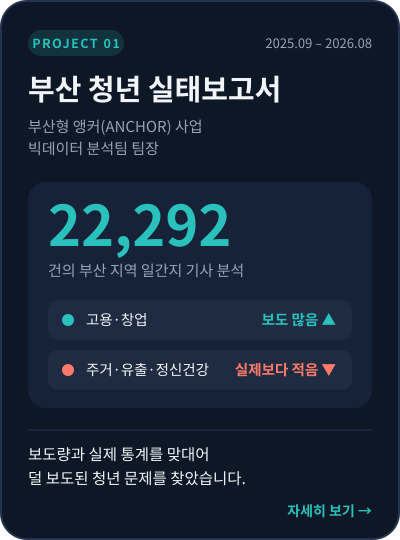
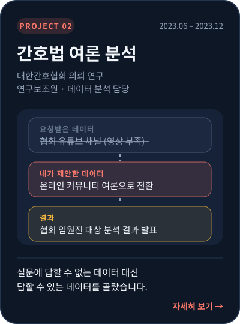
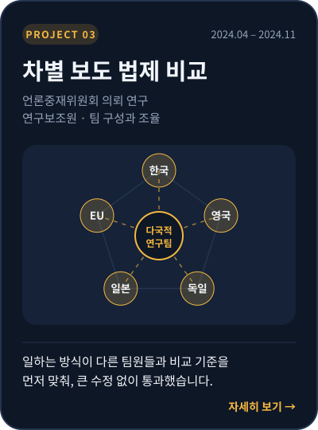

<div align="center">

<a href="https://git.io/typing-svg"></a>



</div>

<br>

## 🙋 About Me

```python
>>> yunseung.info()

name         이윤승 (Yunseung Lee)
role         여론 해석가 · Public Opinion Interpreter
education    부산대학교 미디어커뮤니케이션학 석사 (2026.08, 학점 4.38/4.5)
             부산대학교 미디어커뮤니케이션학 학사 (2024.02)
experience   부산형 앵커(ANCHOR) 사업 빅데이터 분석팀 팀장 (2025.09 – 2026.08)
             한국연구재단 SSK 연구보조원 · 디지털정치표현랩 (2023.08 – 2026.09)
research     국제 학술지 5편 · KCI 2편 게재 · 국제학회(ICA·AEJMC) 발표 4회
strength     평균을 쪼개고, 다른 데이터와 합치고, 없으면 현장에서 새로 모아 해석
```

<table>
<tr>
<th>Language</th><th>Analysis</th><th>Methods</th><th>Data</th>
</tr>
<tr>
<td valign="top">
<br>
<br>
<br>

</td>
<td valign="top">
<br>
<br>
<br>

</td>
<td valign="top">
<br>
<br>
<br>

</td>
<td valign="top">
<br>
<br>
<br>

</td>
</tr>
</table>

<br>

## 🔎 How I Read Data


<br>

## 🗓️ Timeline

<sub>🎓 학업 &nbsp;·&nbsp; 🧭 현장 &nbsp;·&nbsp; 📂 프로젝트 &nbsp;·&nbsp; 🔬 연구 &nbsp;·&nbsp; 📄 논문 &nbsp;·&nbsp; 🌏 국제학회 &nbsp;·&nbsp; 🏆 수상 &nbsp;&nbsp;|&nbsp;&nbsp; <b>밑줄 친 이름을 누르면 해당 페이지로 이동합니다</b></sub>

| 시기 | | 내용 |
|:--|:--:|:--|
| 2018.03 | 🎓 | 부산대학교 미디어커뮤니케이션학과 입학 |
| 2018.06 – 2018.11 | 🧭 | [**서던포스트 현장 설문조사원**](#-field-experience) — 외국인 관광객 설문, 할당 대비 150% 응답 확보 |
| 2019 | 🎖️ | 군 복무 |
| 2021.10 – 2024.01 | 🧭 | [**영남체육신문 축구부 기자**](#-field-experience) — 포항 스틸러스·부산 아이파크 취재 |
| 2023.06 – 2023.12 | 📂 | [**대한간호협회 의뢰 연구 · 간호법 여론 분석**](projects/nursing-law.md) |
| 2023.08 – 2026.09 | 🔬 | 한국연구재단 SSK 연구보조원 · 부산대 디지털정치표현랩 (UNIST 공동 연구) |
| 2024.02 – 2024.03 | 🎓 | 학사 졸업, 같은 학과 석사과정 입학 |
| 2024.02 – 2025.07 | 🧑‍🏫 | 강의 조교(TA) 3과목 — 디지털 저널리즘 · 미디어 글쓰기 · 소셜미디어 데이터 분석 |
| 2024.04 – 2024.11 | 📂 | [**언론중재위원회 의뢰 연구 · 차별 보도 법제 비교**](projects/press-arbitration.md) |
| 2024.05 | 🏆 | [**한국언론학회 대학원생 논문상 최우수상**](#-awards) |
| 2024.06 | 🌏 | [**ICA 연례 학술대회 발표**](#-publications--presentations) (Gold Coast, 호주) |
| 2024 | 📄 | [**KCI 논문 2편 게재**](#-publications--presentations) — 『사회과학연구』 (제1저자 1편) |
| 2025 | 📄 | [**Journal of Broadcasting & Electronic Media 게재**](https://doi.org/10.1080/08838151.2025.2498431) |
| 2025.06 | 🌏 | [**ICA 연례 학술대회 발표**](#-publications--presentations) (Denver, 미국) |
| 2025.08 | 🌏 | [**AEJMC 연례 학술대회 포스터 발표**](#-publications--presentations) (San Francisco, 미국 · 제1저자) |
| 2025.09 – 2026.08 | 📂 | [**부산형 앵커(ANCHOR) 사업 · 빅데이터 분석팀 팀장**](projects/anchor-busan-youth.md) |
| 2025.09 | 🏆 | [**한국연구재단 석사과정생 연구장려금 선정**](#-awards) |
| 2026 | 📄 | [**국제 학술지 4편 게재**](#-publications--presentations) — JMCQ · ICS · OIR · MIA |
| 2026.05 | 🏆 | [**한국언론학회 대학원생 논문상 우수상**](#-awards) |
| 2026.06 | 🌏 | [**ICA 연례 학술대회 발표**](#-publications--presentations) (Cape Town, 남아프리카공화국) |
| 2026.08 | 🎓 | 석사 졸업 (학점 4.38 / 4.5) |

<br>

## 📂 Projects

<table>
<tr>
<td width="33%" align="center"><a href="projects/anchor-busan-youth.md"></a></td>
<td width="33%" align="center"><a href="projects/nursing-law.md"></a></td>
<td width="33%" align="center"><a href="projects/press-arbitration.md"></a></td>
</tr>
<tr>
<td valign="top"><sub><b>쪼개고 합치기</b> · 기사 22,292건의 보도 비중을 실제 통계와 나란히 놓고, 결과를 설문·인터뷰 질문으로 넘겨 현장에서 확인</sub></td>
<td valign="top"><sub><b>데이터 다시 고르기</b> · 요청받은 데이터로는 답이 나오지 않자 대안 데이터를 제안하고, 분석 결과를 의뢰 기관 임원진에게 발표</sub></td>
<td valign="top"><sub><b>사람을 모으고 기준 맞추기</b> · 원문 분석에 필요한 연구원을 직접 섭외해 다국적 팀을 꾸리고, 국가 간 비교 기준을 조율</sub></td>
</tr>
</table>
<p align="center"><sub>*카드를 누르면 프로젝트 상세 페이지로 이동합니다</sub></p>

<br>

## 🧭 Field Experience

### 서던포스트 · 현장 설문조사원 &nbsp;<sub>`2018.06 – 2018.11`</sub>

**부산 주요 관광지(해운대·광안리·용궁사)에서 외국인 관광객 대상 현장 설문조사**

> 응답 한 건에 20분 이상 걸리고, 관광객들이 설문지 앞에서 자꾸 머뭇거리는 상황

- **원인을 현장에서 직접 확인** — 응답자에게 이유를 물어, 지명만으로는 방문지를 떠올리기 어렵고 문항 표현이 어렵다는 두 가지 원인을 찾음
- **바로 고쳐서 실행** — 관광지별 사진 안내 책자를 만들고, 번역 도구와 유학생 선배 검토를 거쳐 문항을 쉬운 표현으로 수정 (회사 검토 후 적용)
- **효과 확인** — 응답 시간을 20분 이상에서 10분 남짓으로 줄이고, 할당 80명 대비 **120명(150%)** 응답을 확보해 추가 수당 수령

### 영남체육신문 · 축구부 기자 &nbsp;<sub>`2021.10 – 2024.01`</sub>

**포항 스틸러스와 부산 아이파크를 2년 3개월간 현장 취재**

- 경기 기사와 칼럼을 쓰고, 축구 데이터를 분석·시각화한 **데이터 저널리즘 기사** 작성
- 선수·서포터 인터뷰로 **숫자가 설명하지 못하는 맥락**을 더함
- '영남 축구팀의 팬덤'을 주제로 서포터즈와 구단 관계자를 인터뷰해 **탐사 기사** 제작
<!-- 대표 기사 링크를 아래 형식으로 넣으세요
- 📰 [기사 제목](https://www.ynsportsnews.co.kr)
-->

<br>

## 🔬 Research in Progress

<sub>학회에서 발표했고 학술지 게재를 준비하거나 탐색 중인 연구입니다.</sub>

| 연구 | 데이터 · 방법 | 핵심 발견 | 현장에 가져갈 시각 |
|:--|:--|:--|:--|
| **사용후핵연료 관련 뉴스 담론 분석**<br><sub>2025 한국소통학회 발표 · 제2저자</sub> | 기사 5,171건 · BERTopic, KOTE 감성 분석, 시계열 분석 | 매체 유형별로 쪼개자 지역 신문은 시설 입지·안전 문제에 집중했고, 모든 토픽에서 전국지보다 부정적이었음 | **쪼개기** — 전체 평균에선 안 보이던 지역 간 차이와, 보도가 급증한 시점의 원인을 찾음 |
| **언론·당파적 유튜브·커뮤니티의 이슈 키워드 네트워크**<br><sub>2025 한국방송학회 발표</sub> | 언론 2,696 · 유튜브 자막 466 · 커뮤니티 27,678건 + 인터뷰 34명 · QAP 네트워크 상관분석 | 언론과 커뮤니티의 이슈 구조가 더 닮았고, 유튜브 안에서도 쇼츠만 다른 이슈를 다룸 | **합치기** — 출처가 다른 데이터를 한 구조 위에 놓고 비교해야 채널마다 다른 모습이 보임 |
| **위치·소비 데이터 기반 행위자 모델(ABM) 파일럿**<br><sub>2026 상반기 · 파일럿 테스트 단계</sub> | 설문 참여자의 위치·카드 사용·미디어 이용 데이터 · 행위자 기반 모델링 | 본 분석 전, 반정형 데이터로 개인 행동을 예측하는 설계 가능성을 시험 | **새로 모으기** — 응답(말)과 위치·소비 기록(행동)을 함께 보는 방법을 탐색 |

<br>

## 📚 Publications & Presentations

<sub>제목을 누르면 논문 페이지로 이동합니다. 굵은 이름이 본인입니다.</sub>

### 학술지 논문

**2026**

1. [**The relationship between political YouTube news use and affective polarization in election vs. non-election contexts: mediation by hostile expression and moderation by political rumor acceptance**](https://doi.org/10.1177/1329878X261494415)<br>
   Kim, B., Lin, H., **Lee, Y.**, & Lee, J. · *Media International Australia*<br>
   <sub>선거 기간과 비선거 기간에 정치 유튜브 뉴스 이용이 정서적 양극화와 어떻게 이어지는지, 적대적 표현(매개)과 정치 루머 수용(조절)을 통해 비교한 연구</sub>

2. [**The Interplay of Agenda Building and Agenda Setting across Policy, Media, and Public Agendas**](https://doi.org/10.1177/10776990261416905)<br>
   Lee, J., **Lee, Y.**, & Kim, B. · *Journalism & Mass Communication Quarterly*<br>
   <sub>정부 브리핑·뉴스 기사·공중 설문 데이터를 합쳐 정책 기관·언론·공중의 의제가 서로 영향을 주고받는 구조를 네트워크 모델로 분석. 언론이 정책과 공중을 잇는 매개 역할을 한다는 점을 실증</sub>

3. [**Does YouTube shape conspiracy mentality? A three-way interaction effect of partisan YouTube channel use, like-minded discussion, and interest in politics**](https://doi.org/10.1080/1369118X.2026.2653097)<br>
   Li, X., **Lee, Y.**, & Kim, B. · *Information, Communication & Society*<br>
   <sub>당파적 유튜브 채널 이용이 음모론적 사고에 영향을 주는지, 같은 생각을 가진 사람과의 대화와 정치 관심도가 함께 작용하는 3원 상호작용으로 검증</sub>

4. [**Ego-Centric News Consumption? Exploring the Cognitive and Affective Outcomes of the News-Finds-Me Perception**]((https://doi.org/10.1108/OIR-04-2025-0223)) 
   Li, X., **Lee, Y.**, & Kim, B. · *Online Information Review*<br>
   <sub>'중요한 뉴스는 알아서 나를 찾아온다'는 인식(News-Finds-Me)이 사람들의 지식과 감정에 어떤 결과를 낳는지 탐색</sub>

**2025**

5. [**News-Driven Discourse and Support for Democratic Norms: Examining Political Knowledge and Tolerance as Moderators**](https://doi.org/10.1080/08838151.2025.2498431)<br>
   Kim, B., Li, X., & **Lee, Y.** · *Journal of Broadcasting & Electronic Media*, 69(3), 294–311<br>
   <sub>뉴스를 계기로 한 대화가 민주적 규범 지지로 이어지는지, 정치 지식과 관용이 그 관계를 어떻게 조절하는지 검증</sub>

**2024 (KCI)**

6. [**정치인 유튜브 선거 캠페인 콘텐츠의 소구 유형과 이용자 참여**] <sub>· 제1저자</sub>(https://scholarworks.dongguk.edu/item/85f6d494-df5c-49c2-9de1-b49815e28ab9)<br>
   **이윤승**, 리시웨, 김범수 · 『사회과학연구』, 32(4), 538–568<br>
   <sub>제22대 총선 부산 지역 후보자 35명의 유튜브 영상 376건을 내용분석해 5개 유형을 도출. 공약 홍보 영상보다 상호작용이 많은 대면 선거 활동 영상에 참여가 몰렸고, 선거일이 다가올수록 후보자 이미지를 앞세운 콘텐츠가 늘어남. 연구 설계부터 게재까지 전 과정 주도</sub>

7. [**Examining Civic Engagement Processes for a National Event: The Moderating Role of YouTube Content**](https://www.dbpia.co.kr/journal/articleDetail?nodeId=NODE11812117)<br>
   리시웨, **이윤승**, 김범수 · 『사회과학연구』, 31(2), 7–33<br>
   <sub>2030 부산세계박람회 유치 과정에서 시민의 감정이 대화와 사회적 자본을 거쳐 참여로 이어지는 경로를 유튜브 영상 내용분석과 부산 시민 설문으로 검증</sub>

### 국제학회 발표

| 연도 | 학회 | 발표 |
|:--|:--|:--|
| 2026.06 | ICA · Cape Town | To Be More Homogeneous? Effects of News-Related Distress and News Customization on Online Homophily |
| 2025.08 | AEJMC · San Francisco | Multi-Group Analysis of Political YouTube Channel-Based News Use, Negativity, and Affective Polarization <sub>(포스터 · 제1저자)</sub> |
| 2025.06 | ICA · Denver | Does YouTube Shape Conspiracy Mentality? |
| 2024.06 | ICA · Gold Coast | Cognitive and Affective Consequences from the News-Finds-Me Perception |

<details>
<summary><b>국내 학회 발표 6건 펼쳐 보기</b></summary>
<br>

| 연도 | 학회 | 발표 |
|:--|:--|:--|
| 2026.05 | 한국언론학회 봄철 정기학술대회 (여수) | 대통령 선거 기간 한국 신문 사설의 도덕 기반과 논조 구성 <sub>(제1저자)</sub> |
| 2025.05 | 한국소통학회 봄철 정기학술대회 (군산) | 사용후 핵연료 관련 뉴스 담론 분석: 2023년 8월 – 2025년 3월 |
| 2025.04 | 한국방송학회 봄철 정기학술대회 (전주) | Issue-keyword network associations between hyper-partisan YouTube channels, online communities and media |
| 2024.10 | 한국언론학회 가을철 정기학술대회 (공주) | 정치인 유튜브 선거 캠페인 콘텐츠의 소구 유형과 이용자 참여 <sub>(단독)</sub> |
| 2024.05 | 한국언론학회 봄철 정기학술대회 (경주) | 뉴스 기반 담론과 민주적 규범 지지: 정치 지식과 관용의 조절 효과 |
| 2023.11 | 한국PR학회 가을철 정기학술대회 (서울) | 국가적 이벤트에 대한 시민 참여 과정 탐색: 유튜브 콘텐츠의 조절 역할 |

</details>

<br>

## 🏆 Awards

| 연도 | 수상 · 선정 | 주최 | 기사 |
|:--|:--|:--|:--:|
| 2026 | **대학원생 논문상 우수상** | 한국언론학회 봄철 정기학술대회 | <!-- [📰 기사](https://comm.or.kr/news/notice1/1000016537) --> |
| 2025.09 | **석사과정생 연구장려금 선정** (1,200만원) | 한국연구재단 |
| 2024 | **대학원생 논문상 최우수상** | 한국언론학회 봄철 정기학술대회 | <!-- [📰 기사](https://m.etoday.co.kr/news/view/2358975) --> |
| 2022.08 | **부산 마약퇴치 홍보 공모전 우수상** | 부산마약퇴치운동본부 |


<sub>장학 · 성적 우수 장학금(7개 학기), 대학원 조교 장학금(4개 학기), 한국연구재단 SSK 연구 지원금(2023.06 – 2026.09)</sub>

<br>

## 📮 Contact

<div align="center">

<a href="mailto:ppuhaha1009@gmail.com"></a>
<a href="mailto:ppuhaha109@naver.com"></a>
<a href="tel:010-2230-1701"></a>

<sub>평균 뒤에 가려진 목소리를 데이터로 읽고, 현장에서 확인하겠습니다.</sub>

</div>
