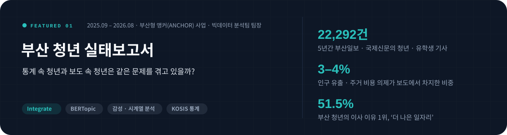
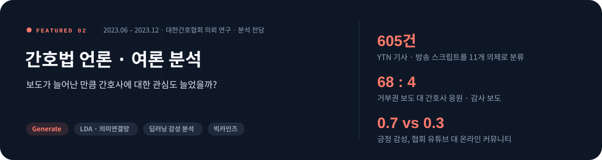
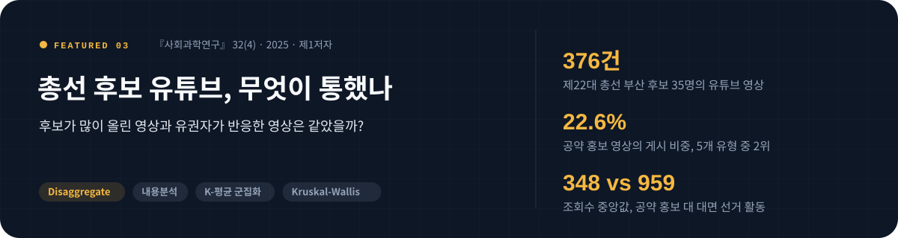

 

## Profile

 

## Timeline

 

## Toolkit

 

## Beyond the Average

평균이 말해주지 않는 실제를 찾기 위해, 데이터를 세 가지 방식으로 다룹니다.

 

## Featured Work

여론 해석가로서 일하는 방식이 가장 잘 드러나는 세 가지 작업입니다. 이미지나 제목을 누르면 분석 과정과 결과를 정리한 상세 페이지로 이동합니다.

 

### 01 &nbsp;부산 청년 실태보고서 &nbsp;`2025.09 – 2026.08`

**부산형 앵커(ANCHOR) 사업 · 빅데이터 분석팀 팀장** &nbsp; `Python` `BERTopic` `감성 분석` `시계열 분석` `상관분석` `KOSIS`

> 청년 통계와 지역 언론 기사를 같은 의제 기준으로 맞대어, 통계가 보여 주는 청년의 현실과 언론이 다루는 청년 문제 사이의 간극을 찾았습니다. 보고서의 양식, 분석 방법, 결과 작성을 맡았습니다.

- **평균을 연령대로 쪼개 이탈 시점을 특정** — 청년(만 18–39세)을 하나로 보지 않고 나누자, 대학 입학기인 18–24세는 순유입이지만 사회 진출기인 25–29세에서 순유출이 가장 컸습니다 (약 5,000명).
- **통계와 보도를 같은 기준으로 대조** — 청년 인구는 8년간 18.3% 줄었고 이사 이유 1위는 '더 나은 일자리'(51.5%)였지만, 인구 유출과 주거 비용 의제는 보도의 각각 3–4%에 그쳤습니다.
- **보도가 비어 있는 의제를 발견** — 청년의 57.7%가 부모와 함께 살고 우울증상 유병률은 2년 새 3.3%에서 7.9%로 늘었지만, 주거 형태는 독립된 의제조차 되지 못했고 청년 건강 · 저출산 보도는 한 해 최대 3건이었습니다.
- **분석을 현장 조사로 연결** — 찾은 간극을 설문(약 500명) · 인터뷰(40여 명) 문항으로 바꿔, 당사자의 목소리로 다시 검증하도록 설계에 참여했습니다.
- 심사위원회 발표에서 "데이터 없이는 알 수 없는 부분을 잘 밝혔다"는 평가 &nbsp;·&nbsp; [**상세 분석 보기 →**](projects/anchor-busan-youth.md)

 

### 02 &nbsp;간호법 언론 · 여론 분석 &nbsp;`2023.06 – 2023.12`

**대한간호협회 의뢰 연구 · 보조연구원 (데이터 수집 · 분석 · 결과 기술 전담)** &nbsp; `Python` `LDA` `의미연결망` `딥러닝 감성 분석` `비시민성 분석` `빅카인즈`

> 간호법 제정 논쟁 당시 언론 보도와 온라인 여론을 분석했습니다. 처음부터 모든 분석을 정해 두지 않고, 앞 단계의 결과가 다음 질문과 데이터를 정하도록 분석을 이어 갔습니다.

- **보도량을 쪼개 분석 대상을 좁힘** — 빅카인즈로 2021년 1월부터 2023년 5월까지의 보도를 월별 · 언론사별 · 성향별로 나누자 YTN이 두드러져, YTN 기사 · 방송 스크립트 605건을 11개 의제로 분류하고 추이를 추적했습니다.
- **보도량 증가가 곧 관심 증가는 아니었음** — 대통령 거부권 보도는 68건으로 가장 많았던 반면 간호사 응원 · 감사 보도는 4건에 그쳐, 보도의 중심이 간호사에서 정치 갈등으로 옮겨 갔습니다.
- **답할 수 없는 데이터 대신 새 데이터를 제안** — 협회가 요청한 자체 유튜브는 영상이 31개뿐이고 관심층 반응에 치우쳐 있어, 디시인사이드 등 커뮤니티 4곳을 중심 데이터로 제안했습니다. 실제로 긍정 감성은 유튜브 0.7, 커뮤니티 0.3으로 크게 갈렸습니다.
- **부정 감성을 반대 여론으로 단정하지 않음** — 커뮤니티의 부정 감성과 비시민성은 높았지만, 원문을 확인하니 법보다 정치 쟁점을 향한 표현이 많아 문제를 '쟁점의 정치화와 오해'로 진단했습니다.
- 협회 임원진 앞에서 결과를 발표하고, 간호법을 지역 의료 인력 부족을 해결하는 법으로 알리는 의제 전환을 제안 &nbsp;·&nbsp; [**상세 분석 보기 →**](projects/nursing-law.md)

 

### 03 &nbsp;총선 후보 유튜브, 무엇이 통했나 &nbsp;`2024.05 – 2025.12`

**『사회과학연구』 32(4) 제1저자 · 연구 설계부터 데이터 구축, 분석, 게재까지 주도** &nbsp; `Python` `scikit-learn` `K-means` `Kruskal-Wallis` `내용분석`

> 제22대 총선 부산 후보 35명이 선거 기간에 올린 유튜브 영상 376건을 직접 보고 코딩한 뒤 군집화로 유형을 나누고, 유형별로 이용자 반응을 비교했습니다.

- **분류를 감이 아닌 데이터로 검증** — 영상을 보며 귀납적으로 만든 12개 유목(코더 간 신뢰도 κ = .88)을, 유목별 시간을 속성으로 한 K-평균 군집화로 다시 검증해 5개 유형으로 정리했습니다.
- **많이 올린 것과 반응한 것이 달랐음** — 공약 홍보 영상은 게시 비중 2위(22.6%)였지만 조회수 중앙값은 348회로, 대면 선거 활동 영상(959회)의 약 36%에 그쳤습니다. 댓글과 좋아요에서도 가장 낮았습니다 (Kruskal-Wallis, 모두 p < .001).
- **정당과 시점으로 쪼개자 전략 차이가 드러남** — 두 진영 모두 대면 선거 활동 영상이 가장 많았지만, 그다음으로 보수 후보는 공약 홍보(29.8%), 진보 후보는 방송 출연 영상(22.8%)을 많이 올렸습니다 (χ² = 11.43, p < .05). 선거일이 다가올수록 가장 크게 늘어난 것도 대면 선거 활동 영상이었습니다 (B = .16).
- 2024 한국언론학회 가을철 정기학술대회 발표 &nbsp;·&nbsp; [DOI](https://doi.org/10.46415/jss.2025.12.32.4.537) &nbsp;·&nbsp; [**상세 분석 보기 →**](projects/politician-youtube-campaign.md)

 

## Publications

제목을 누르면 원문으로 이동합니다.

### Journal Articles

**2026**

- **[The Interplay of Agenda Building and Agenda Setting across Policy, Media, and Public Agendas](https://doi.org/10.1177/10776990261416905)** 
  *Journalism & Mass Communication Quarterly* &nbsp;·&nbsp; Lee, J., **Lee, Y.**, & Kim, B.

- **[Does YouTube Shape Conspiracy Mentality? A Three-Way Interaction Effect of Partisan YouTube Channel Use, Like-Minded Discussion, and Interest in Politics](https://doi.org/10.1080/1369118X.2026.2653097)** 
  *Information, Communication & Society* &nbsp;·&nbsp; Li, X., **Lee, Y.**, & Kim, B.

- **[The Relationship between Political YouTube News Use and Affective Polarization in Election vs. Non-Election Contexts: Mediation by Hostile Expression and Moderation by Political Rumor Acceptance](https://doi.org/10.1177/1329878X261494415)** 
  *Media International Australia* &nbsp;·&nbsp; Kim, B., Lin, H., **Lee, Y.**, & Lee, J.

- **[How News-Finds-Me Perception Relates to Affective Polarization: User-Centric News Evaluation and Political Figure-Centered Talk as Mediating Mechanisms](https://doi.org/10.1108/OIR-04-2025-0223)** 
  *Online Information Review* &nbsp;·&nbsp; Li, X., **Lee, Y.**, & Kim, B.

**2025**

- **[정치인 유튜브 선거 캠페인 콘텐츠의 소구와 이용자 참여](https://doi.org/10.46415/jss.2025.12.32.4.537)** &nbsp;제1저자 
  『사회과학연구』, 32(4) &nbsp;·&nbsp; **이윤승**, 리시웨, 김범수 &nbsp;·&nbsp; [분석 정리](projects/politician-youtube-campaign.md)

- **[News-Driven Discourse and Support for Democratic Norms: Examining Political Knowledge and Tolerance as Moderators](https://doi.org/10.1080/08838151.2025.2498431)** 
  *Journal of Broadcasting & Electronic Media*, 69(3) &nbsp;·&nbsp; Kim, B., Li, X., & **Lee, Y.**

**2024**

- **[Examining Civic Engagement Processes for a National Event: The Moderating Role of YouTube Content](https://www.dbpia.co.kr/journal/articleDetail?nodeId=NODE11812117)** 
  『사회과학연구』, 31(2) &nbsp;·&nbsp; 리시웨, **이윤승**, 김범수

### Conference Presentations

- **ICA 2026**, Cape Town — To Be More Homogeneous? Effects of News-Related Distress and News Customization on Online Homophily
- **AEJMC 2025**, San Francisco — Multi-Group Analysis of Political YouTube Channel-Based News Use, Negativity, and Affective Polarization 제1저자 · 포스터
- **ICA 2025**, Denver — Does YouTube Shape Conspiracy Mentality?
- **ICA 2024**, Gold Coast — Cognitive and Affective Consequences from the News-Finds-Me Perception

국내 학회 발표 6건

 

- **한국언론학회 2026 봄**, 여수 — 대통령 선거 기간 한국 신문 사설의 도덕 기반과 논조 구성 제1저자
- **한국소통학회 2025 봄**, 군산 — 사용후 핵연료 관련 뉴스 담론 분석: 2023년 8월 – 2025년 3월
- **한국방송학회 2025 봄**, 전주 — Issue-keyword network associations between hyper-partisan YouTube channels, online communities and media
- **한국언론학회 2024 가을**, 공주 — 정치인 유튜브 선거 캠페인 콘텐츠의 소구 유형과 이용자 참여 단독
- **한국언론학회 2024 봄**, 경주 — 뉴스 기반 담론과 민주적 규범 지지: 정치 지식과 관용의 조절 효과
- **한국PR학회 2023 가을**, 서울 — 국가적 이벤트에 대한 시민 참여 과정 탐색: 유튜브 콘텐츠의 조절 역할

 

## Awards

| 연도 | 수상 · 선정 | 기관 | |
|:--|:--|:--|:--|
| 2026 | **대학원생 논문상 우수상** | 한국언론학회 | [기사](https://comm.or.kr/news/notice1/1000016537) |
| 2025 | **석사과정생 연구장려금 선정** | 한국연구재단 | |
| 2024 | **대학원생 논문상 최우수상** | 한국언론학회 | [기사](https://m.etoday.co.kr/news/view/2358975) |
| 2022 | **부산 마약퇴치 홍보 공모전 우수상** | 부산마약퇴치운동본부 | |

장학 · 성적 우수 장학금(7개 학기), 대학원 조교 장학금(4개 학기), 한국연구재단 SSK 연구 지원금(2023 – 2026)

 

## Contact

