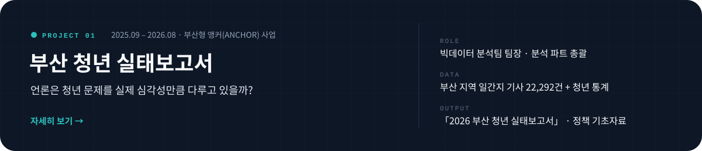
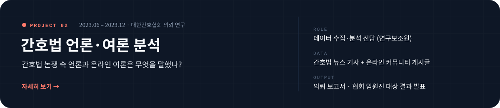
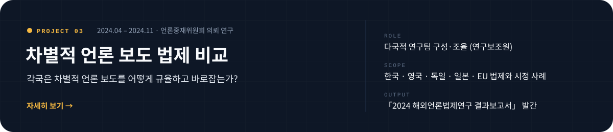
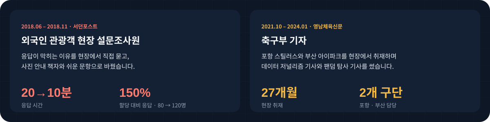
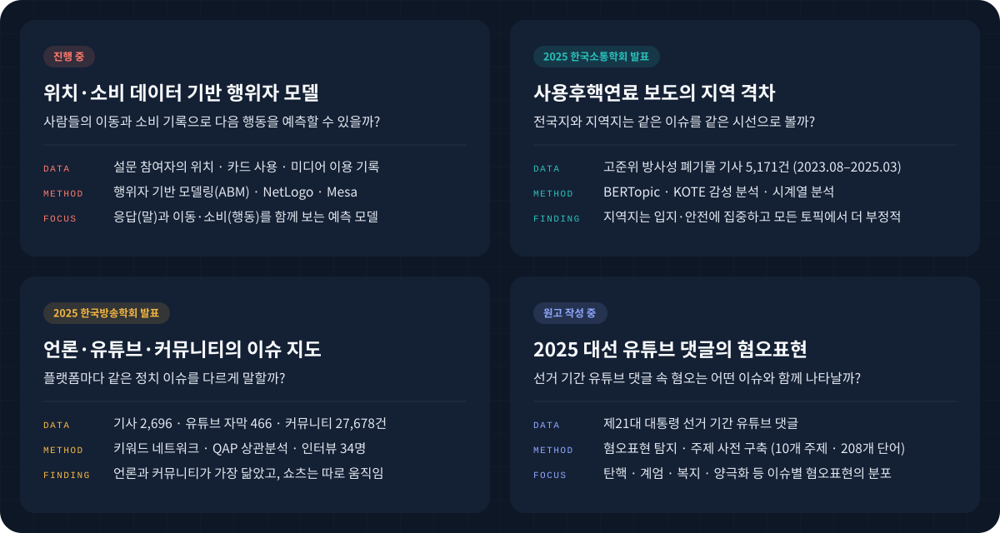

 

## Profile

 

## Timeline

 

## Toolkit

 

## Beyond the Average

평균이 말해주지 않는 실제를 찾기 위해, 데이터를 세 가지 방식으로 다룹니다.

 

## Projects

카드를 누르면 프로젝트 상세 페이지로 이동합니다.

 

## Field Work

데이터 밖의 사람을 직접 만나 온 경험입니다.

 

## Research in Progress

학회에서 발표했거나 원고를 쓰고 있는 연구입니다.

 

## Publications

제목을 누르면 연구 모형과 방법, 주요 내용을 정리한 페이지로 이동합니다.

### Journal Articles

**2026**

- **[The Interplay of Agenda Building and Agenda Setting across Policy, Media, and Public Agendas](papers/agenda-building-setting.md)** 
  *Journalism & Mass Communication Quarterly* &nbsp;·&nbsp; Lee, J., **Lee, Y.**, & Kim, B. &nbsp;·&nbsp; [DOI](https://doi.org/10.1177/10776990261416905)

- **[Does YouTube Shape Conspiracy Mentality? A Three-Way Interaction Effect of Partisan YouTube Channel Use, Like-Minded Discussion, and Interest in Politics](papers/youtube-conspiracy-mentality.md)** 
  *Information, Communication & Society* &nbsp;·&nbsp; Li, X., **Lee, Y.**, & Kim, B. &nbsp;·&nbsp; [DOI](https://doi.org/10.1080/1369118X.2026.2653097)

- **[The Relationship between Political YouTube News Use and Affective Polarization in Election vs. Non-Election Contexts](papers/youtube-affective-polarization.md)** 
  *Media International Australia* &nbsp;·&nbsp; Kim, B., Lin, H., **Lee, Y.**, & Lee, J. &nbsp;·&nbsp; [DOI](https://doi.org/10.1177/1329878X261494415)

- **[Ego-Centric News Consumption? Exploring the Cognitive and Affective Outcomes of the News-Finds-Me Perception](papers/news-finds-me.md)** 
  *Online Information Review* &nbsp;·&nbsp; Li, X., **Lee, Y.**, & Kim, B. &nbsp;·&nbsp; [DOI](https://doi.org/10.1108/OIR-04-2025-0223)

**2025**

- **[News-Driven Discourse and Support for Democratic Norms: Examining Political Knowledge and Tolerance as Moderators](papers/news-discourse-democratic-norms.md)** 
  *Journal of Broadcasting & Electronic Media*, 69(3) &nbsp;·&nbsp; Kim, B., Li, X., & **Lee, Y.** &nbsp;·&nbsp; [DOI](https://doi.org/10.1080/08838151.2025.2498431)

**2024**

- **[정치인 유튜브 선거 캠페인 콘텐츠의 소구 유형과 이용자 참여](papers/politician-youtube-campaign.md)** &nbsp;제1저자 
  『사회과학연구』, 32(4) &nbsp;·&nbsp; **이윤승**, 리시웨, 김범수 &nbsp;·&nbsp; [원문](https://scholarworks.dongguk.edu/item/85f6d494-df5c-49c2-9de1-b49815e28ab9)

- **[Examining Civic Engagement Processes for a National Event: The Moderating Role of YouTube Content](papers/expo-civic-engagement.md)** 
  『사회과학연구』, 31(2) &nbsp;·&nbsp; 리시웨, **이윤승**, 김범수 &nbsp;·&nbsp; [원문](https://www.dbpia.co.kr/journal/articleDetail?nodeId=NODE11812117)

### Conference Presentations

- **ICA 2026**, Cape Town — To Be More Homogeneous? Effects of News-Related Distress and News Customization on Online Homophily
- **AEJMC 2025**, San Francisco — Multi-Group Analysis of Political YouTube Channel-Based News Use, Negativity, and Affective Polarization 제1저자 · 포스터
- **ICA 2025**, Denver — Does YouTube Shape Conspiracy Mentality?
- **ICA 2024**, Gold Coast — Cognitive and Affective Consequences from the News-Finds-Me Perception

국내 학회 발표 6건

 

- **한국언론학회 2026 봄**, 여수 — 대통령 선거 기간 한국 신문 사설의 도덕 기반과 논조 구성 제1저자
- **한국소통학회 2025 봄**, 군산 — 사용후 핵연료 관련 뉴스 담론 분석: 2023년 8월 – 2025년 3월
- **한국방송학회 2025 봄**, 전주 — Issue-keyword network associations between hyper-partisan YouTube channels, online communities and media
- **한국언론학회 2024 가을**, 공주 — 정치인 유튜브 선거 캠페인 콘텐츠의 소구 유형과 이용자 참여 단독
- **한국언론학회 2024 봄**, 경주 — 뉴스 기반 담론과 민주적 규범 지지: 정치 지식과 관용의 조절 효과
- **한국PR학회 2023 가을**, 서울 — 국가적 이벤트에 대한 시민 참여 과정 탐색: 유튜브 콘텐츠의 조절 역할

 

## Awards

| 연도 | 수상 · 선정 | 기관 | |
|:--|:--|:--|:--|
| 2026 | **대학원생 논문상 우수상** | 한국언론학회 | [기사](https://comm.or.kr/news/notice1/1000016537) |
| 2025 | **석사과정생 연구장려금 선정** | 한국연구재단 | |
| 2024 | **대학원생 논문상 최우수상** | 한국언론학회 | [기사](https://m.etoday.co.kr/news/view/2358975) |
| 2022 | **부산 마약퇴치 홍보 공모전 우수상** | 부산마약퇴치운동본부 | |

장학 · 성적 우수 장학금(7개 학기), 대학원 조교 장학금(4개 학기), 한국연구재단 SSK 연구 지원금(2023 – 2026)

 

## Contact

