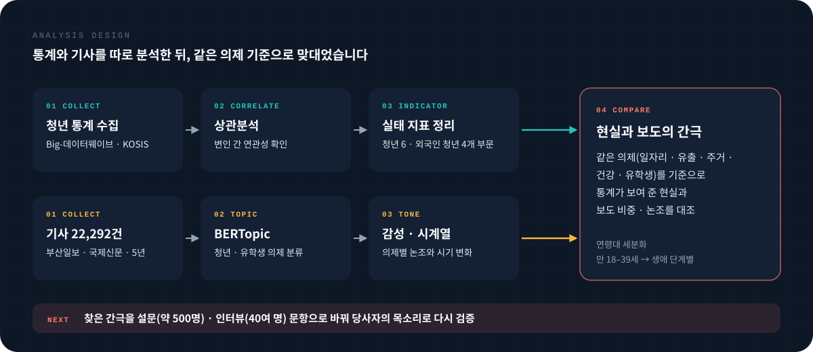
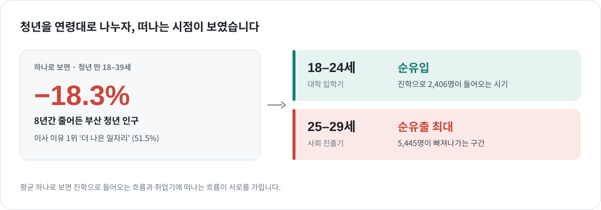
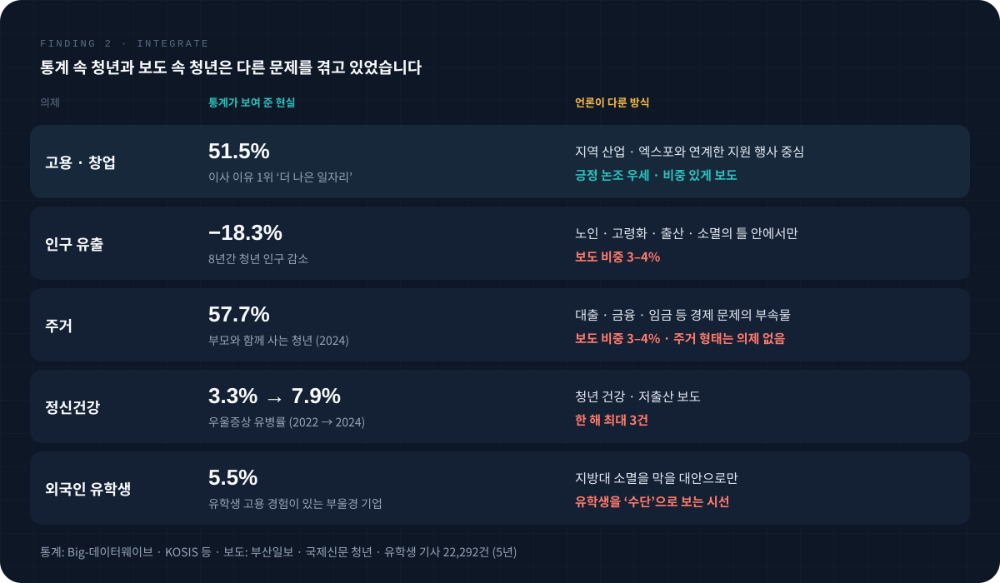

<a href="../README.md#featured-work">← Featured Work</a>

 

FEATURED 01 &nbsp;·&nbsp; 2025.09 – 2026.08 &nbsp;·&nbsp; 부산대학교 앵커사업단  &nbsp;·&nbsp; 총괄

# 부산대학교 앵커사업단 부산 거주 청년 및 유학생 실태 보고서

**언론은 간호법을 어떻게 보도했고, 온라인 이용자는 어떻게 반응했을까?**

  
  
   
  
  

| 항목 | 내용 |
|:--|:--|
| 보고서 | **2023 간호법 제정에 관한 국내 언론보도와 국민여론 분석** |
| 의뢰 | 대한간호협회 |
| 역할 | 보조연구원  · 데이터 수집 · 분석, 결과 기술, 발표 자료 초안 |
| 데이터 | 빅카인즈 보도 (2021.01 – 2023.05) · YTN 방송 스크립트 **605건** · 온라인 커뮤니티 4곳 게시글 · 협회 유튜브 댓글 **4,336개** |
| 공개 자료 | [언론 보도 데이터 (CSV)](../assets/data/medical_all.csv) &nbsp;·&nbsp; [유튜브 댓글 데이터 (CSV)](../assets/data/YTC.csv) &nbsp;·&nbsp; [커뮤니티 댓글 데이터 (CSV)](../assets/data/sentiment_analysis_result_fm.csv) &nbsp;·&nbsp; [변수 설명](../assets/data/README1.md) |

 
 

## 분석 질문

> **언론이 많이 다룬 청년 문제가 곧 실제로 심각한 문제일까?**

언론이 자주 다루는 문제는 정책에서도 중요한 문제로 받아들여지기 쉽습니다. 그래서 통계가 보여 주는 청년의 현실과 언론이 다룬 청년 문제를 같은 의제 기준으로 맞대어, 둘이 어긋나는 지점을 찾았습니다.

 

## 분석 설계

| 단계 | 한 일 |
|:--|:--|
| **통계 정리** | Big-데이터웨이브와 KOSIS 통계로 현황을 먼저 파악하고, 상관분석으로 변인 간 연관성을 살펴 사업단이 요구하는 실태 지표를 청년 6개, 외국인 청년 4개 부문으로 정리 |
| **세분화** | 통계상 청년(만 18–39세) 범위가 넓어 생애 단계별 차이가 가려진다고 보고, 연령대별로 나누어 다시 분석 |
| **기사 분석** | 5년간 부산일보 · 국제신문의 청년 · 유학생 기사 22,292건을 BERTopic으로 의제별로 나누고, 감성 분석과 시계열 분석으로 의제별 논조와 시기 변화를 확인 |
| **대조** | 일자리 · 인구 유출 · 주거 · 정신건강 · 유학생의 다섯 의제를 기준으로, 통계가 보여 준 현실과 보도 비중 · 논조를 나란히 비교 |

 

## 결과 1 · 평균을 쪼개자 떠나는 시점이 보였다

청년 전체로 보면 "8년간 청년 인구 18.3% 감소"라는 하나의 숫자만 남습니다. 연령대로 나누자 서로 다른 두 흐름이 드러났습니다. 대학 입학기인 18–24세는 오히려 부산으로 들어오고, 사회 진출기인 25–29세에서 약 5,000명이 빠져나가며 순유출이 가장 컸습니다. 이사 이유 1위가 '더 나은 일자리'(51.5%)라는 통계와 함께 보면, 청년 유출은 **취업 시점의 이탈**이라는 점이 분명해집니다.

 

## 결과 2 · 통계 속 청년과 보도 속 청년

- **고용 · 창업** — 가장 비중 있게 보도된 의제였습니다. 다만 지역 산업 · 엑스포와 연계한 지원 행사 소식이 중심이었고 긍정 논조가 우세했습니다.
- **인구 유출** — 8년간 청년 인구가 18.3% 줄었지만 보도 비중은 3–4%에 그쳤습니다. 그마저도 노인 · 고령화 · 출산 · 소멸 같은 키워드와 함께, 지역 소멸이라는 큰 틀 안에서만 언급됐습니다.
- **주거** — 2024년 기준 청년의 57.7%가 부모와 함께 살고 1인 가구는 매년 늘고 있지만, 주거 보도는 대출 · 근로 · 금융 · 임금 같은 경제 키워드에 묶여 있었습니다. 주거 유형, 주거 환경 같은 **주거 형태는 독립된 의제조차 형성하지 못했습니다.** 사업단의 핵심 주제가 바로 청년 주거 형태였습니다.
- **정신건강** — 우울증상 유병률은 2022년 3.3%에서 2024년 7.9%로 두 배 넘게 늘었고, 청년 자살률은 2023년에도 10만 명당 23.59명으로 높은 수준이었습니다. 반면 청년 건강 · 저출산 보도는 한 해 최대 3건이었습니다.
- **외국인 유학생** — 유학생을 고용해 본 부울경 기업은 5.5%뿐이었지만, 언론은 유학생을 지방대 소멸을 막을 대안으로만 다뤘습니다.

 

## 결과 3 · 간극을 당사자의 목소리로 다시 확인

분석 결과를 다음 단계인 사회조사에서 바로 쓸 수 있도록, 서베이팀과 인터뷰팀에 주요 결과와 물어볼 질문을 추려 전달하고 문항 설계에 참여했습니다. 인터뷰에는 **부산을 떠나고 싶은지와 그 이유**, **언론이 자신의 의견을 대변한다고 느끼는지**를 묻는 문항을 넣어, 보고서에서 찾은 간극을 당사자에게 다시 확인하도록 했습니다.

설문 · 인터뷰 결과와 대조하자 간극은 더 분명해졌습니다. 언론은 청년과 유학생을 지역 소멸을 막을 '**수단**'으로 그렸지만, 당사자들은 부산에 머물기를 원하며 이를 가능하게 할 일자리와 정책을 요구하는 '**주체**'였습니다. 이 간극을 보고서의 핵심 결론으로 담았습니다.

| 성과 | 내용 |
|:--|:--|
| 심사 평가 | 앵커사업단 심사위원회 발표에서 "심사위원도 놓칠 수 있는, 데이터 없이는 알 수 없는 부분을 잘 밝혔다"는 평가 |
| 현장 조사 | 설계에 참여한 문항이 약 500명 대상 설문과 40여 명 인터뷰에 활용 |
| 활용 | 청년 일자리 · 창업 지원, 정신건강 · 자살 예방, 복지 사각지대 발굴 정책의 기초자료로 활용 예정 |

 

---

[Featured Work로 돌아가기](../README.md#featured-work) &nbsp;·&nbsp; [다음: 간호법 언론 · 여론 분석 →](nursing-law.md)
