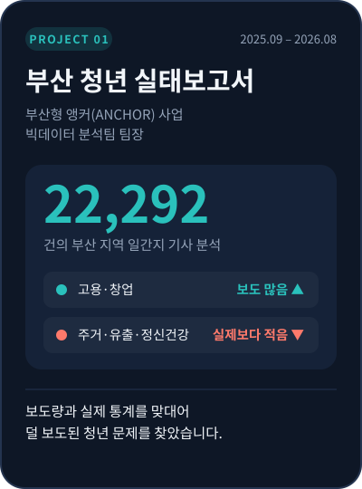

[← 포트폴리오로 돌아가기](../README.md)



# 📂 부산 청년 실태보고서

**언론은 부산 청년 문제를 실제 심각성만큼 다루고 있을까?**

부산형 앵커(ANCHOR) 사업에서 빅데이터 분석팀 팀장을 맡아, 지역 일간지의 청년 보도를 실제 통계와 맞대어 보고 「2026년 부산 청년 실태보고서」를 작성했습니다.

| 항목 | 내용 |
|:--|:--|
| 기간 | 2025.09 – 2026.08 |
| 사업 | 부산형 앵커(ANCHOR) 사업 「지역사회 문제 해결 시민 공감형 혁신 밀리우 구축」<br><sub>부산광역시와 지역 대학이 협력해 시민 대상 AI 교육과 빅데이터 기반 지역 분석을 수행하는 사업</sub> |
| 역할 | 연구보조원 · **빅데이터 분석팀 팀장** |
| 데이터 | 부산일보·국제신문의 청년·외국인 유학생 관련 기사 **22,292건** + 청년 관련 실제 통계 |
| 방법 | 토픽 모델링 · 감성 분석 · 시계열 분석 · 보도 비중과 실제 통계 비교 |
| 결과물 | 「2026년 부산 청년 실태보고서」 |

<br clear="right"/>

---

## ① 문제 정의 — 무엇을 확인하려 했나

언론이 자주 다루는 문제는 시민과 정책 담당자에게 "중요한 문제"로 받아들여집니다. 반대로 실제로는 심각한데 보도가 적은 문제는 정책에서도 뒤로 밀리기 쉽습니다.

그래서 질문을 이렇게 세웠습니다.

> **보도의 양(인식)과 실제 통계(현실) 사이에 차이가 나는 청년 문제는 무엇인가?**

## ② 데이터로 진단 — 쪼개고, 합치기

| 단계 | 한 일 |
|:--|:--|
| **쪼개기** | 기사 22,292건을 토픽 모델링으로 주제별로 나누고, 시계열 분석으로 시기별 보도 흐름을 확인 |
| **합치기** | 주제별 보도 비중을 고용·주거·인구 유출·정신건강 등 실제 통계와 나란히 놓고 비교 |
| **감성 분석** | 같은 주제라도 어떤 논조로 다뤄지는지 확인 |

<!-- 그래프를 넣으려면 projects 폴더에 이미지를 올리고 아래 주석을 푸세요

-->

## ③ 현장으로 넘기기 — 새로 모으기

빅데이터 분석은 "어디가 다르다"까지는 보여주지만 "왜 다른지"는 말해주지 않습니다. 그래서 분석에서 나온 **핵심 발견과 후보 질문을 설문팀(약 500명)과 인터뷰팀(약 40명)에 넘기고, 문항 설계를 함께** 했습니다. 데이터에서 세운 가설을 현장의 목소리로 확인하는 구조입니다.

```
기사 데이터 분석 → 보도와 현실의 차이 발견 → 설문·인터뷰 질문으로 전환 → 현장에서 확인
```

## ④ 결과

- 청년 **고용·창업** 문제는 비중 있게 보도되었습니다.
- 반면 **주거, 청년 유출, 정신건강** 문제는 실제 심각성에 비해 보도가 부족했습니다.
- 보고서는 청년 일자리·창업 지원, 정신건강·자살 예방, 복지 사각지대 발굴 정책의 기초자료로 활용될 예정입니다.

## 내 역할

- 빅데이터 분석팀 보고서의 **형식, 분석 방법, 결과 작성을 주도**
- 분석 설계와 수행 (토픽 모델링, 감성 분석, 시계열 분석, 통계 비교)
- 분석 결과를 설문팀·인터뷰팀이 쓸 수 있는 질문으로 바꿔 전달하고 문항 설계 지원

## 🛵 배달 현장에 적용한다면

- **지표와 체감의 차이부터 찾겠습니다.** "보도량 vs 실제 통계"를 나란히 놓았던 것처럼, 권역의 배달 지표를 시간대·지역별로 쪼개 평균에 가려진 구간을 먼저 찾겠습니다.
- **데이터의 가설을 현장 질문으로 바꾸겠습니다.** 지표에서 찾은 이상 신호를 라이더와 가게 사장님께 물어볼 질문으로 바꿔, 현장에서 원인을 확인하겠습니다.

<br>

[← 포트폴리오로 돌아가기](../README.md) &nbsp;·&nbsp; [다음 프로젝트: 간호법 여론 분석 →](nursing-law.md)
