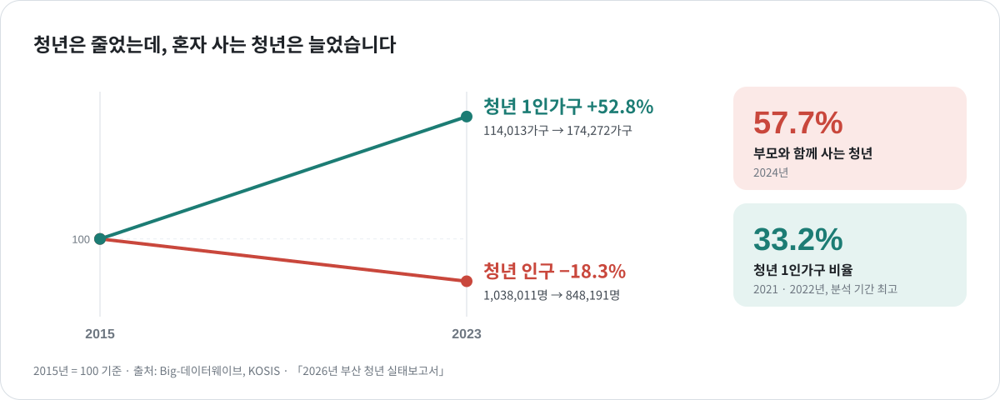
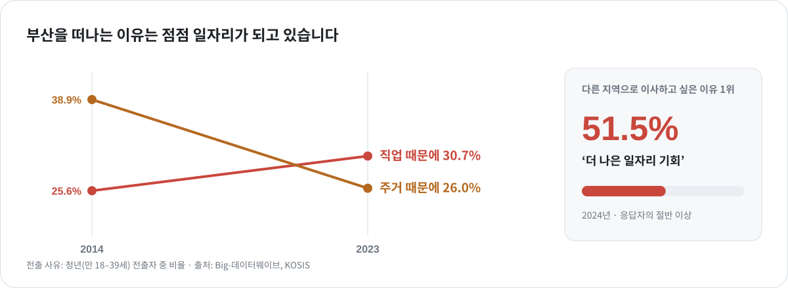
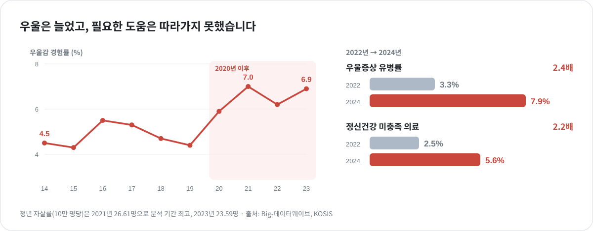
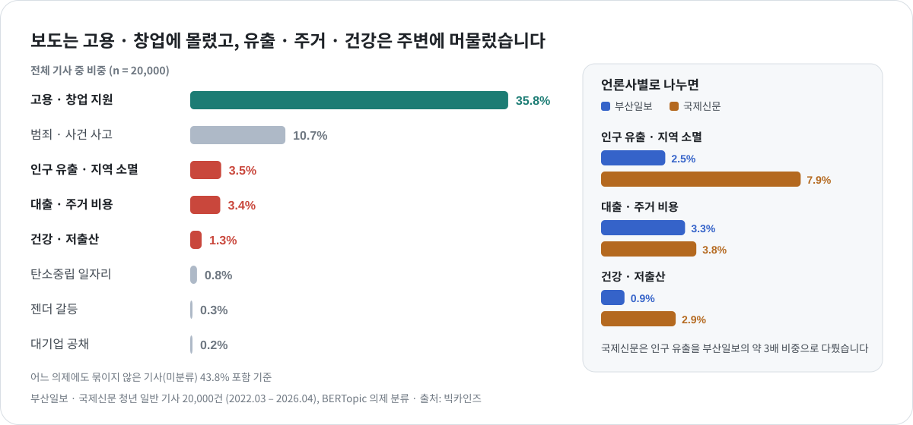
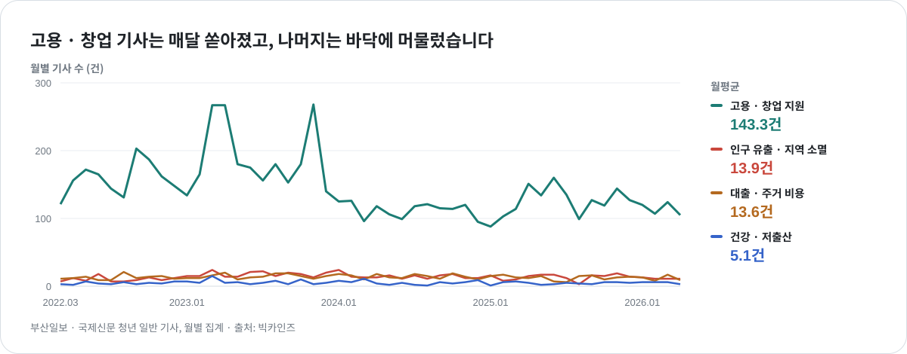
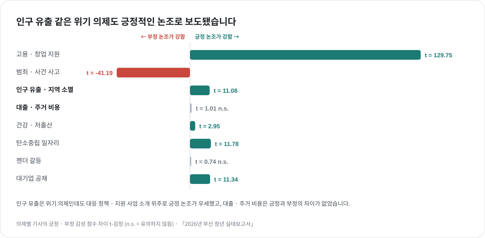
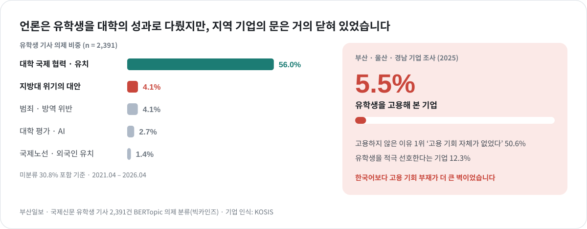

<a href="../README.md#featured-work">← Featured Work</a>

 

 2025.09 – 2026.08 &nbsp;·&nbsp; 부산대학교 앵커사업단  &nbsp;·&nbsp; 총괄

# 부산대학교 앵커사업단 부산 거주 청년 및 유학생 실태 보고서

**언론은 부산 청년과 유학생이 실제로 겪는 문제를 다루고 있을까?**

  
  
   
  
  

| 항목 | 내용 |
|:--|:--|
| 보고서 | **부산 거주 청년 및 유학생 실태 보고서** |
| 사업 | 부산대학교 앵커사업단  |
| 역할 | 연구원  · 데이터 수집 · 분석, 결과 기술, 발표 |
| 데이터 | 부산일보 & 국제신문 기사 (2021.04 – 2026.04) **2,2292건** · KOSIS & Big-데이터웨이브  **4,336개** |
| 공개 자료 | [Big-데이터웨이브 ](https://data.busan.go.kr/bdip/) &nbsp;·&nbsp; [KOSIS](https://kosis.kr/index/index.do) &nbsp;·&nbsp; [언론 데이터 (CSV)](../assets/data/%E1%84%8E%E1%85%A5%E1%86%BC%E1%84%82%E1%85%A7%E1%86%AB_%E1%84%89%E1%85%A1%E1%84%89%E1%85%A5%E1%86%AF_%E1%84%80%E1%85%B5%E1%84%89%E1%85%A1.csv) &nbsp;·&nbsp; [분석 코드](../assets/code/anchor_statistics.py) &nbsp;·&nbsp; [변인 생성](../assets/data/README2.md)|

 

## 연구 문제

앵커사업단 빅데이터 분석팀은 부산의 청년 인구 감소 문제를 정리하여 지역 정책의 기초자료로 삼고자 했습니다. 지역 언론은 지역의 문제를 진단하고 해결책을 제시하는 역할을 한다는 점에서, 언론이 무엇을 다루는지가 지자체 정책에 영향을 미칠 수 있습니다. 이에 통계를 통해 청년과 유학생의 현실을 먼저 정리한 뒤, 지역 언론이 다룬 청년·유학생 의제와 비교하여 둘 사이의 어긋나는 지점을 찾고자 했습니다.

| 구분 | 분석 질문 |
|:--|:--|
| **통계** | 부산 거주 청년과 유학생이 겪는 어려움은 무엇이며, 연령에 따라 어떻게 다른가? |
| **언론** | 지역 언론은 청년과 유학생의 어려움을 얼마나, 어떤 논조로 다루는가? |
| **비교** | 통계가 보여 준 현실을 언론이 다루고 있는가? |

 

## 분석 방법

- **통계 자료 분석** — 공공데이터 포털인 빅데이터웨이브와 KOSIS에서 부산 거주 청년 관련 통계 자료를 수집하여 현황을 먼저 파악했습니다. 상관분석을 통해 변인 간 연관성을 살펴보았으며, 이를 바탕으로 사업단이 요구한 실태 지표를 청년 6개 부문(인구·건강·경제·일자리·복지·창업)과 유학생 4개 부문(인구·체류·취업·기업 인식)으로 정리했습니다.
- **기사 분석** — 빅카인즈에서 부산일보와 국제신문의 청년 기사 20,000건과 유학생 기사 2,292건을 수집하여, BERTopic을 활용해 청년 8개, 유학생 5개 의제로 분류했습니다. 이후 의미연결망 분석을 통해 의제 내 주요 키워드 간 관계를 살펴보고, 감성 분석과 의제별 t-검정으로 논조를 비교했으며, 시계열 분석으로 보도량의 변화를 확인했습니다.
- **대조** — 일자리·인구 유출·주거·정신건강·유학생의 다섯 가지 의제를 기준으로, 통계가 보여주는 현실과 보도 비중 및 논조를 비교했습니다.

 

## 결과 1 · 통계로 본 부산 거주 청년의 현실

2015년부터 2023년까지 청년 인구는 18.3% 줄었지만, 청년 1인가구는 오히려 52.8% 늘었습니다. 남아 있는 청년이 더 작은 단위로 흩어져 살고 있다는 뜻입니다. 한편 2024년 기준 청년의 57.7%는 여전히 부모와 함께 거주하는 경향을 보였습니다.

청년을 하나로 보면 "인구 18.3% 감소"라는 숫자만 남습니다. 연령대로 나누자 서로 다른 두 흐름이 드러났습니다. 대학 입학기인 18–24세는 부산으로 유입되는 반면(18–19세 +859명, 20–24세 +1,547명), 사회 진출기인 25–29세에서 5,445명이 빠져나가며 순유출이 가장 컸습니다(2023년). 즉, 부산으로 들어온 청년이 졸업 후 부산에서 일자리를 구해 정착하기보다는, 대학을 졸업한 후 다른 지역으로 떠나는 경향을 보였습니다. 부산은 청년이 머무는 도시라기보다 대학 시절을 보내고 떠나는 도시에 가까웠습니다.

떠나는 이유도 바뀌고 있었습니다. 청년 전출 사유 가운데 직업은 2014년 25.6%에서 2023년 30.7%로 늘었고, 주거는 38.9%에서 26.0%로 줄었습니다. 다른 지역으로 이사하고 싶은 이유 1위도 '더 나은 일자리'(51.5%)였습니다. 앞서 본 연령대별 이동과 함께 보면, 청년 유출은 **취업 시점에 일자리를 찾아 떠나는 이탈**이었고, 부산은 청년에게 **대학 시절을 보내는 곳**에 머물러 있었습니다.

정신건강 지표는 2020년 이후 나빠졌습니다. 우울감 경험률은 2019년 4.4%에서 2021년 7.0%로 올라 2023년에도 6.9%에 머물렀습니다. 2022년에서 2024년 사이 우울증상 유병률은 3.3%에서 7.9%로 2.4배, 도움이 필요했지만 의료 서비스를 받지 못한 비율은 2.5%에서 5.6%로 2.2배 늘었습니다. 필요한 도움이 수요를 따라가지 못하고 있었습니다.

- **상관 분석** — 통계를 영역별로만 보면 "실업률이 높다", "우울감이 늘었다"처럼 따로 떨어진 사실만 남습니다. 그래서 영역이 다른 지표를 맞대어, 연관성이 있는 지표가 있는지 확인했습니다.
  - **방법** — 16개 구군의 고용 · 건강 · 부채 · 창업 · 전출 지표를 짝지어 7쌍의 관계를 비교했습니다. 전출인구, 채무보유자, 신규 사업체 수는 인구가 많은 구군일수록 커지므로, 청년 인구(취업자 ÷ 고용률로 역산) 대비 비율로 바꿔 비교했습니다. 7쌍을 한꺼번에 검정하면 우연히 유의한 결과가 나올 수 있어, 보정한 p값(Benjamini-Hochberg)도 함께 봤습니다.
  - **결과** — 고용률이 높은 구군일수록 우울감 경험률이 낮았습니다(r = −.55, 95% CI −.82 ~ −.07, p = .028). 즉, 고용이 우울감에 직접적인 영향을 준다고는 볼 수 없지만, 일자리 여건이 좋은 구군일수록 청년의 정신건강 지표도 양호한 경향이 있었습니다. 보정 후에는 유의하지 않아 탐색적 결과로 보았지만, 청년 일자리 정책과 정신건강 지원을 함께 설계할 근거를 찾는 출발점으로 삼았습니다.
  - **연도별 비교** — 부산 전체의 연도별 지표도 함께 맞대어 보았습니다. 희망임금과 전출자 수는 원래 값 기준으로는 강한 상관관계(r = −.71, p = .02)를 보였습니다. 그러나 희망임금은 해마다 꾸준히 상승하는 값(연도와의 상관 r = .99)이었기 때문에, 전년 대비 변화량끼리 다시 비교하자 상관관계는 유의하지 않았습니다(r = −.60, p = .09). 즉 두 지표가 같은 시기에 함께 변화한 것일 뿐, 서로 영향을 주고받았다는 근거는 되지 못했습니다.
  - [분석 코드](../assets/code/anchor_statistics.py) · [데이터 · 변수 설명](../assets/data/anchor/README.md)

 

## 결과 2 · 언론이 다룬 청년

청년 기사 2만 건 가운데 지역 산업·엑스포와 연계한 고용·창업 박람회 홍보 기사가 35.8%로 가장 많았고, 범죄·사건사고가 10.7%로 그 뒤를 이었습니다. 반면 통계상 심각하게 나타난 인구 유출(3.5%), 대출·주거 비용(3.4%), 건강·저출산(1.3%) 관련 보도는 상대적으로 미미한 비중에 그쳤습니다. 언론사별로는 국제신문이 인구 유출을 7.9% 비중으로 다루어, 부산일보(2.5%)의 약 3배에 달했습니다.

이러한 쏠림 현상은 특정 시기에만 나타난 것이 아니었습니다. 창업 박람회 홍보 기사는 월평균 143건씩 꾸준히 보도된 반면, 인구 유출과 주거 비용 관련 기사는 월 14건 안팎, 건강·저출산 관련 기사는 월 5건에 그쳤습니다. 특히 건강·저출산 보도는 저출산 통계나 정부 대책이 발표될 때에만 일시적으로 증가하는 양상을 보였습니다.

논조 역시 현실과 달랐습니다. 인구 유출은 시급한 의제였음에도 대응 정책과 지원 사업을 소개하는 기사가 많아 오히려 긍정 논조가 우세했습니다(t = 11.08). 대출·주거 비용은 긍정과 부정의 차이가 뚜렷하지 않았고, 부정적으로 나타난 의제는 범죄·사건사고 의제뿐이었습니다. 즉, 청년은 정책의 수혜자이거나 사건의 당사자로만 그려졌으며, 취업 관련 기사 역시 부산시의 정책과 박람회를 홍보하는 내용으로 채워져 있었습니다. 반면 일자리를 찾아 떠나는 당사자로서는 거의 다뤄지지 않았습니다.

 

## 결과 3 · 통계 속 청년과 보도 속 청년

| 의제 | 통계가 보여 준 현실 | 언론이 다룬 방식 |
|:--|:--|:--|
| **고용 · 창업** | 이사 희망 이유 1위 '더 나은 일자리' **51.5%** | 보도 비중 35.8%로 1위. 지원 행사 소식 중심, 긍정 논조 |
| **인구 유출** | 8년간 청년 인구 **18.3%** 감소, 25–29세 **5,445명** 순유출 | 보도 비중 3.5%. 고령화 · 출산 · 지역 소멸이라는 큰 틀 안에서만 언급 |
| **주거** | 부모와 함께 사는 청년 **57.7%**, 청년 1인가구 **52.8%** 증가 | 보도 비중 3.4%. 대출 · 금융 · 임금 맥락에서만 언급, 주거 형태는 독립된 의제가 되지 못함 |
| **정신건강** | 우울증상 유병률 **3.3% → 7.9%** (2022 → 2024) | 건강 · 저출산 보도 비중 1.3%. 정책 발표 때만 드물게 보도 |
| **유학생** | 유학생을 고용해 본 부울경 기업 **5.5%** | 대학의 국제 협력 성과(56.0%)와 지방대 소멸의 대안으로 다룸 |

언론이 가장 많이 다룬 일자리 의제 역시 '지원 행사' 소식이었으며, 취업 시점에 청년이 떠난다는 사실은 지역 소멸이라는 큰 틀에 묻혀 제대로 드러나지 않았습니다. 사업단의 핵심 주제였던 청년 주거 형태는 독립된 의제로조차 다뤄지지 못했습니다. 이를 종합하면, 언론은 지역 산업 홍보와 지원 행사, 대학의 유학생 유치 성과와 같은 소식을 주로 보도한 반면, 일자리를 찾아 부산을 떠나는 청년과 정신건강 문제는 거의 다루지 않았습니다. 통계가 보여준 청년의 현실과 언론이 그려낸 청년의 모습 사이에는 뚜렷한 간극이 존재했습니다.

 

## 결과 4 · 유학생: 대학의 성과와 닫힌 취업 문

유학생 기사 2,292건 가운데 56.0%가 대학 간 국제 협력과 유치 성과를 다뤘고, 4.1%는 유학생을 지방대 소멸을 막을 대안으로 다뤘습니다. 그러나 2025년 부울경 기업 가운데 유학생을 고용해 본 곳은 5.5%에 불과했고, 고용하지 않은 이유 1위는 한국어 문제가 아니라 '고용 기회 자체가 없었다'(50.6%)였습니다. 언론은 유학생을 데려오는 일에만 주목했을 뿐, 졸업 후 지역에서의 취업 지원과 정착 문제에는 크게 주목하지 않았습니다. 즉 언론은 유학생을 주로 지역 대학을 살리기 위한 **수단**으로만 다루었을 뿐, 유학생이 부산에서 어떻게 적응하며 살아가는지, 졸업 후에도 부산에 머물며 일할 수 있는지에 대한 논의는 독립된 의제로 다루지 않았습니다.

 

## 결과 5 · 간극을 당사자의 목소리로 다시 확인

분석 결과를 다음 단계인 사회조사에서 바로 쓸 수 있도록, 설문조사팀과 인터뷰팀에 주요 결과와 질문 후보를 추려 전달했습니다. 두 팀에는 이미 만든 문항이 있었지만, 청년과 유학생의 관점이 언론에 반영되지 않는다는 분석 결과를 근거로 설득해 기존 문항은 살리면서 새 문항을 더했습니다. 인터뷰에는 **부산을 떠나고 싶은지와 그 이유**, **언론이 자신의 의견을 대변한다고 느끼는지**를 묻는 문항이 들어갔습니다.

설문 · 인터뷰 결과와 대조하자 간극은 더 분명해졌습니다. 언론은 청년과 유학생을 지역 소멸을 막을 '**수단**'으로 그렸지만, 당사자들은 부산에 머물기를 원하며 이를 가능하게 할 일자리와 정책을 요구하는 '**주체**'였습니다. 이 간극을 보고서의 핵심 결론으로 담았습니다.

| 성과 | 내용 |
|:--|:--|
| 심사 평가 | 앵커사업단 심사위원회 발표에서 "심사위원도 놓칠 수 있는, 데이터 없이는 알 수 없는 부분을 잘 밝혔다"는 평가 |
| 현장 조사 | 설계에 참여한 문항이 약 500명 대상 설문과 40여 명 인터뷰에 활용 |
| 활용 | 청년 일자리 · 창업 지원, 정신건강 · 자살 예방, 복지 사각지대 발굴 정책의 기초자료로 활용 예정 |

 

## 주요 의의

- **데이터를 다양한 기준에 따라 분리했습니다.** 만 19–39세를 하나로 보면 "청년 인구 18.3% 감소"라는 숫자만 남습니다. 연령대로 나누자 취업기인 25–29세의 이탈이 드러났고, 언론사로 나누자 같은 지역 신문 안에서도 인구 유출을 다루는 비중이 3배 차이 났습니다.
- - **언론 보도와 실제 청년 사이의 괴리를 발견했습니다** 통계 분석에 따르면 부산 거주 청년들은 구직난과 정신건강 문제 등으로 많은 어려움을 겪고 있었습니다. 그러나 언론은 이를 깊이 있게 보도하기보다는 부산시가 시행하는 정책 및 박람회를 홍보하는 데 그쳐, 지역 언론 본연의 역할을 제대로 수행하지 못하고 있었습니다.
- **분석을 다음 조사로 연결했습니다.** 설문조사팀과 인터뷰팀에 분석 결과를 제시해 이를 반영한 문항을 추가했고, 데이터로 찾은 간극을 당사자의 답으로 다시 확인할 수 있게 했습니다.

 

---

[Featured Work로 돌아가기](../README.md#featured-work) &nbsp;·&nbsp; [다음: 간호법 언론 · 여론 분석 →](nursing-law.md)
