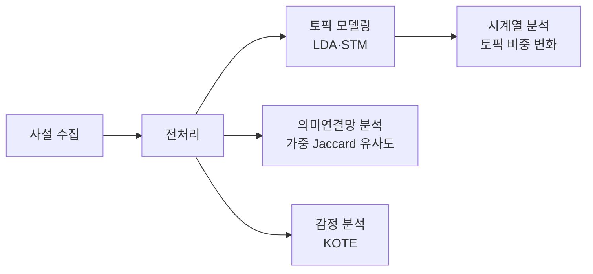

# 📰 부산 지역 신문의 청년·외국인 유학생 보도 분석

> 부산일보·국제신문 사설은 청년과 외국인 유학생을 어떻게 그리는가?  
> 텍스트 마이닝으로 지역 언론의 의제와 프레임을 분석한 프로젝트입니다.

[← 포트폴리오로 돌아가기](../README.md)

## 1. 프로젝트 개요

| 항목 | 내용 |
|---|---|
| 기간 | 20XX.XX - 20XX.XX |
| 역할 | (예: 데이터 수집·전처리·분석 전 과정, 결과 해석 및 보고서 작성) |
| 데이터 | 부산일보·국제신문 사설 N건 (20XX - 20XX) |
| 사용 기술 | Python, pandas, (토픽 모델링 패키지명), KOTE |

## 2. 분석 질문

지역 언론은 지역 사회가 어떤 문제를 중요하게 여길지 정하는 데 영향을 줍니다.  
이 프로젝트는 부산의 청년과 외국인 유학생이 지역 신문 사설에서 어떻게 다뤄지는지 데이터로 확인하고자 했습니다.

1. 청년·외국인 유학생 관련 사설에서 어떤 주제가 주로 다뤄지는가?
2. 주제의 비중은 시간에 따라 어떻게 변했는가?
3. 핵심 단어들은 어떤 의미 구조(연결망)를 이루는가?
4. 사설에 담긴 감정은 어떤 특성을 보이는가?

## 3. 분석 과정

| 단계 | 방법 | 목적 |
|---|---|---|
| 전처리 | (형태소 분석기 이름), 불용어 제거 | 분석 가능한 단어 단위로 정리 |
| 토픽 모델링 | LDA·STM | 사설이 다루는 주제 추출 |
| 시계열 분석 | 토픽 비중의 시간 변화 | 의제가 언제, 어떻게 바뀌었는지 확인 |
| 의미연결망 분석 | 가중 Jaccard 유사도 | 단어 간 연결 구조로 프레임 파악 |
| 감정 분석 | KOTE | 사설의 감정 톤 분석 |

## 4. 주요 결과

### ① 청년 보도 : 취업·엑스포 프레임의 지배

- 청년 관련 사설에서는 취업과 엑스포 관련 주제가 가장 큰 비중을 차지했습니다 (비중 N%).
- 반면 주거·젠더 이슈는 구조적으로 과소 보도되었습니다 (비중 N%).

### ② 외국인 유학생 보도 : 범죄·위험 프레임

- 외국인 유학생 관련 사설은 범죄·위험 프레임으로 다뤄지는 경향이 나타났습니다.
- (연결망에서 '유학생'과 강하게 연결된 단어 예시 : ○○, ○○, ○○)

### ③ 시계열·감정 분석 결과

- (한 줄 해석 — 예: 엑스포 유치 논의 시기에 관련 토픽 비중이 급증)
- (한 줄 해석 — 감정 분석 결과)

## 5. 시사점

- (예: 지역 언론의 보도가 청년 정책 논의를 취업 중심으로 좁힐 수 있어, 주거·젠더 등 놓친 의제를 발굴할 필요가 있음)
- (예: 같은 분석 방법을 기업·브랜드 관련 보도 모니터링에도 적용할 수 있음)

## 6. 회고

- **어려웠던 점과 해결** : (예: 토픽 수 결정 → 지표 값과 해석 가능성을 함께 비교해 결정)
- **다시 한다면** : (예: 온라인 커뮤니티 데이터와 결합해 언론 의제와 여론 의제를 비교)

## 7. 관련 자료

- [보고서 또는 논문](링크) ← 링크가 없으면 이 줄을 삭제하세요

