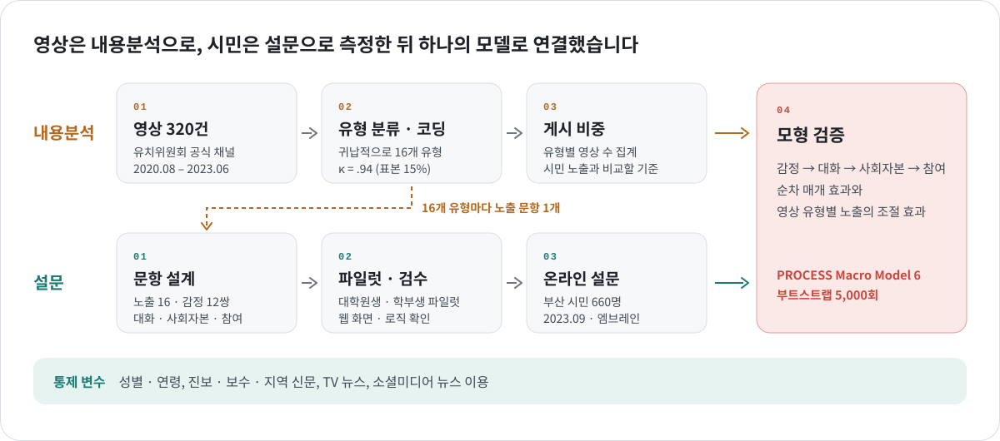
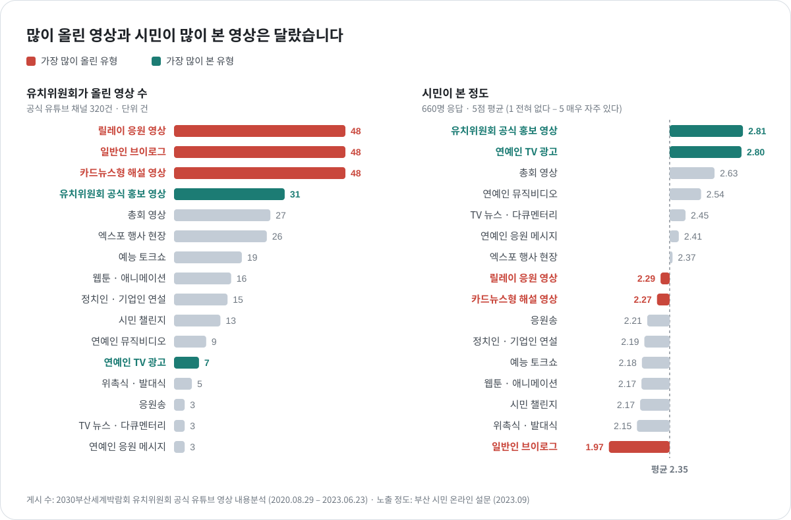
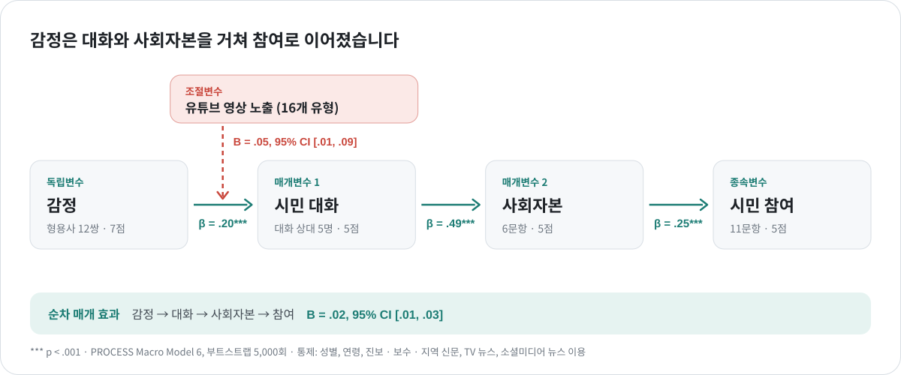
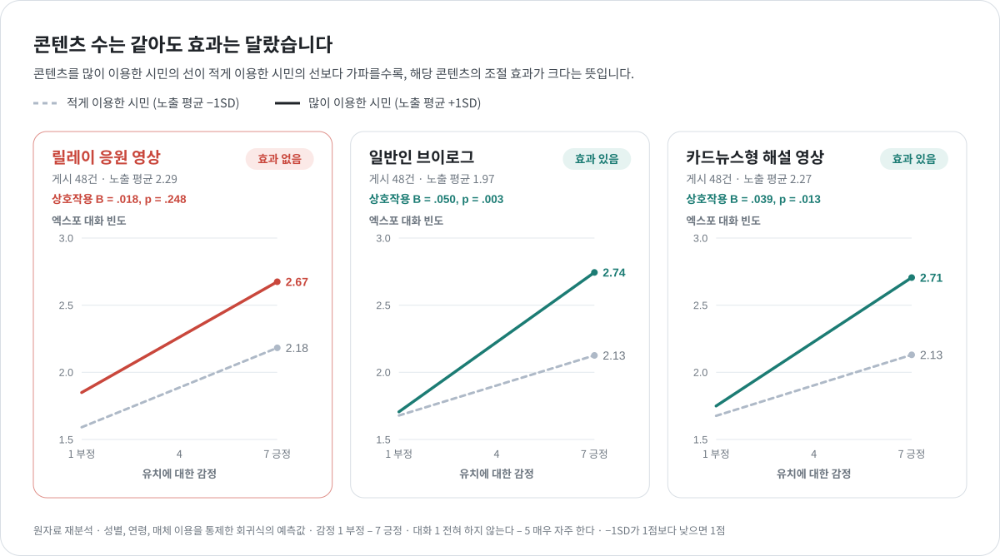

<a href="../README.md#featured-projects">← Featured Projects</a>

 

『사회과학연구』 31권2호 &nbsp;·&nbsp; 2024 &nbsp;·&nbsp; 제2저자

# Examining Civic Engagement Processes for a National Event: The Moderating Role of YouTube Content

**유치위원회가 올린 유튜브 영상은 부산 시민의 대화와 참여로 이어졌을까?**

  
  
   
  

| 항목 | 내용 |
|:--|:--|
| 논문 | **Examining Civic Engagement Processes for a National Event: The Moderating Role of YouTube Content** 국가적 이벤트에 대한 시민 참여 과정 탐색: 유튜브 콘텐츠의 조절 역할 |
| 학술지 | 『사회과학연구』 31권2호, 2024 &nbsp;·&nbsp; [논문 보기](https://www.dbpia.co.kr/journal/articleDetail?nodeId=NODE11812117) |
| 저자 | 리시웨, **이윤승** (제2저자), 김범수 |
| 역할 | 유튜브 콘텐츠 내용분석, 설문 문항 설계, 파일럿 조사, 웹 설문 검수, 스크리닝 조건 설정 연구 모델 설계, 데이터 분석, 방법론 및 결과 기술 |
| 데이터 | 유치위원회 공식 유튜브 영상 **320건** (2020.08.29 – 2023.06.23) · 부산 시민 온라인 설문 **660명** |
| 공개 자료 | [유튜브 콘텐츠 내용분석 코드북 (PDF)](../assets/data/codebook.pdf) &nbsp;·&nbsp; [유튜브 콘텐츠 내용분석 코딩 데이터 (CSV)](../assets/data/expo_contentanalysis.csv) &nbsp;·&nbsp; [설문조사지 (PDF)](../assets/data/expo_survey.pdf) &nbsp;·&nbsp; [설문조사 데이터 (CSV)](../assets/data/expo_data.csv) &nbsp;·&nbsp; [변수 설명](../assets/data/README5.md) &nbsp;·&nbsp; [분석 코드](../assets/code/expo.py) |

 

## 연구 문제

2023년 부산은 2030 세계박람회 유치를 두고 사우디아라비아 리야드, 이탈리아 로마와 경쟁하고 있었고, 유치위원회는 공식 유튜브 채널에 영상을 올리며 시민의 지지를 모으고자 했습니다. 홍보 영상은 시민이 유치에 관심을 갖고 주변과 이야기하며 참여하게 만드는 계기가 될 수 있다는 점에서, 어떤 영상이 그 역할을 했는지 확인할 필요가 있었습니다. 이에 유치에 대한 시민의 감정이 주변과의 대화, 지역 공동체에 대한 신뢰와 유대(사회자본)를 거쳐 시민 참여로 이어지는지 살펴보고, 어떤 유형의 영상이 이 과정을 강화하는지 확인하고자 했습니다.

| 구분 | 연구 질문 |
|:--|:--|
| **유치위원회** | 공식 유튜브 채널에는 어떤 유형의 콘텐츠가 얼마나 올라왔으며, 부산 시민은 어떤 콘텐츠를 가장 많이 시청했는가? |
| **시민** | 유치에 긍정적인 감정을 가진 시민일수록 엑스포 관련 시민 참여로 이어지는가? |
| **조절** | 어떤 유형의 영상에 노출된 시민일수록 긍정적 감정이 엑스포 관련 대화로 더 강하게 이어지는가? |

 

## 조사 개요

| 항목 | 내용 |
|:--|:--|
| 조사 대상 | 부산 거주 만 20–69세 성인 |
| 표본 | **660명** · 남 201 / 여 459 · 20대 119 / 30대 219 / 40대 175 / 50대 100 / 60대 47 |
| 조사 방법 | 온라인 패널 조사 (엠브레인 실사) |
| 조사 기간 | 2023.09.13 – 09.15 · 개최지 발표(2023.11) 두 달 전 |
| 문항 구성 | 본 문항 75개 (Q1 – Q8) |
| 품질 관리 | 파일럿 조사 → 웹 설문 화면 · 로직 검수 → 전처리 단계 불성실 응답 점검 (제외 0명) |
| 분석 | PROCESS Macro Model 6 순차 매개 효과(부트스트랩 5,000회) · 조절 효과 검증, 성별 · 연령 · 매체 이용 통제 |

 

## 연구 설계 및 방법

- **내용분석** — 유치위원회 공식 유튜브 채널의 영상 320건(2020.08.29 – 2023.06.23)을 연구진과 함께 시청하며 귀납적으로 16개 유형을 도출했습니다. 유형마다 정의를 정리한 코드북으로 해당 여부(1/0)를 코딩했고, 표본의 15%(48건)로 측정한 코더 간 신뢰도는 Cohen’s κ = .94입니다. 유형별 영상 수는 시민이 실제로 본 정도와 비교하는 기준으로 썼습니다.
- **설문** — 내용분석으로 찾은 16개 유형마다 노출 문항을 하나씩 만들었고, 감정 · 대화 · 사회자본 · 참여 문항은 선행 척도를 엑스포 상황에 맞게 고쳤습니다. 대학원생 · 학부생 대상 파일럿과 웹 설문 화면 · 로직 검수를 거쳐, 엠브레인 패널의 부산 시민 660명에게 응답을 받았습니다(2023.09.13 – 09.15).
- **모형 검증** — 성별 · 연령과 신문 · TV · 소셜미디어 뉴스 이용을 통제하고, PROCESS Macro Model 6으로 감정 → 대화 → 사회자본 → 참여의 순차 매개 효과와 영상 유형별 노출의 조절 효과를 검증했습니다(부트스트랩 5,000회).

 

## 결과 1 · 위원회가 게시한 콘텐츠와 이용자가 주로 시청한 콘텐츠 사이에 괴리가 있었다

320개의 영상을 연구진과 함께 시청하며 귀납적으로 유형을 분류했습니다. 유형마다 정의를 정리한 코드북을 만들어 영상이 각 유형에 해당하는지(1/0) 코딩했고, 표본의 15%(48건)로 측정한 코더 간 신뢰도는 Cohen’s κ = .94입니다. 이렇게 나온 16개 유형을 그대로 설문의 노출 문항으로 옮겼습니다.

유치위원회는 릴레이 응원 영상, 일반인 브이로그, 카드뉴스형 해설 영상을 각 48건으로 가장 많이 올렸지만, 세 유형 모두 시민이 본 정도는 평균(2.35)보다 낮았습니다. 시민이 가장 많이 본 영상은 유치위원회 공식 홍보 영상(2.81)과, 7건밖에 없던 연예인 TV 광고(2.80)였습니다.

## 결과 2 · 엑스포에 대한 긍정적 감정은 대화와 사회자본을 거쳐 시민 참여로 이어졌다

| 경로 | 계수 | 결과 |
|:--|--:|:--|
| 긍정적 감정 → 시민 대화 | β = .20*** | 지지 |
| 시민 대화 → 사회자본 | β = .49*** | 지지 |
| 사회자본 → 시민 참여 | β = .25*** | 지지 |
| 긍정적 감정 → 대화 → 사회자본 → 참여 (순차 매개) | B = .02, 95% CI [.01, .03] | 지지 |
| 긍정적 감정 × 유튜브 영상 노출 → 시민 대화 (조절) | B = .05, 95% CI [.01, .09] | 지지 |

*** p < .001 · 성별, 연령, 진보 · 보수 · 지역 신문, TV 뉴스, 소셜미디어 뉴스 이용 통제

엑스포 유치에 긍정적인 감정을 가진 시민일수록 주변과 엑스포 이야기를 더 자주 했고, 대화가 많을수록 사회자본이 높았으며, 이는 다시 시민 참여로 이어졌습니다. 유튜브 영상에 많이 노출된 시민일수록 감정이 대화로 이어지는 관계도 더 강했습니다.

 

## 결과 3 · 엑스포 유치에 대한 긍정적 감정과 관련 대화의 관계는 유튜브 콘텐츠에 의해 조절되었다

| 구분 | 영상 유형 |
|:--|:--|
| **조절 효과 있음 (11개)** | 연예인 TV 광고, 웹툰 · 애니메이션, 유치위원회 공식 홍보 영상, 총회 영상, 엑스포 행사 현장, 시민 챌린지, 위촉식 · 발대식, 연예인 응원 메시지, 정치인 · 기업인 연설, 일반인 브이로그, 카드뉴스형 해설 영상 |
| **조절 효과 없음 (5개)** | 연예인 뮤직비디오, 예능 토크쇼, 응원송, TV 뉴스 · 다큐멘터리, **릴레이 응원 영상** |

 

## 주요 의의

결과 3 그림을 새로 만들었습니다(expo-posted-seen.svg). 게시 수 막대를 빼고, 조절 효과 자체를 보여 주는 그래프로 바꿔 결과 1과 겹치지 않습니다.

똑같이 48건씩 올라온 세 유형(릴레이 응원 영상, 일반인 브이로그, 카드뉴스형 해설 영상)을 나란히 놓았습니다. 각 그래프는 감정이 긍정적일수록 엑스포 대화가 얼마나 늘어나는지를, 영상을 많이 본 시민과 적게 본 시민으로 나눠 선 두 개로 보여 줍니다. 브이로그와 카드뉴스는 두 선이 크게 벌어지고, 릴레이는 거의 나란히 갑니다.

그림이 바뀌었으니 결과 3 섹션은 아래처럼 바꾸시면 됩니다.

markdown
## 결과 3 · 많이 올린 영상이 효과 있는 영상은 아니었다

릴레이 응원 영상, 일반인 브이로그, 카드뉴스형 해설 영상은 모두 48건씩 올라왔지만 효과는 달랐습니다. 브이로그와 카드뉴스형 해설 영상은 많이 본 시민일수록 긍정적인 감정이 대화로 더 강하게 이어졌지만, 릴레이 응원 영상은 많이 본 시민과 적게 본 시민 사이에 유의한 차이가 없었습니다. 16개 유형 전체로 보면 11개 유형에서 조절 효과가 나타났습니다.

| 구분 | 영상 유형 |
|:--|:--|
| **조절 효과 있음 (11개)** | 연예인 TV 광고, 웹툰 · 애니메이션, 유치위원회 공식 홍보 영상, 총회 영상, 엑스포 행사 현장, 시민 챌린지, 위촉식 · 발대식, 연예인 응원 메시지, 정치인 · 기업인 연설, 일반인 브이로그, 카드뉴스형 해설 영상 |
| **조절 효과 없음 (5개)** | 연예인 뮤직비디오, 예능 토크쇼, 응원송, TV 뉴스 · 다큐멘터리, **릴레이 응원 영상** |

그림 속 계수와 p값(예: 브이로그 B = .050, p = .003)은 논문에는 없는 숫자로, 원자료를 다시 분석해서 얻었습니다. 그래서 그림 아래에 "원자료 재분석"이라고 적어 두었습니다. 세 유형 모두 효과가 있는지 없는지는 논문 결과와 같습니다.

Expo posted seen
이미지
·SVG

콘텐츠의 개수는 같아도 효과는 달랐습니다. 
콘텐츠를 많이 이용한 시민의 선이 적게 이용한 시민보다 기울기가 가파를수록, 해당 콘텐츠가 조절 효과의 크기가 컸습니다. 

문맥에 맞게 수정

콘텐츠 수는 같아도 효과는 달랐습니다. 콘텐츠를 많이 이용한 시민의 선이 적게 이용한 시민의 선보다 가파를수록, 해당 콘텐츠의 조절 효과가 크다는 뜻입니다.
"해당 콘텐츠가 조절 효과의 크기가 컸습니다": 주어가 두 개 겹쳐 문법이 맞지 않아 "해당 콘텐츠의 조절 효과가 크다는 뜻입니다"로 고쳤습니다. 그래프를 읽는 방법을 설명하는 문장이라 “~뜻입니다”가 맞습니다.
"적게 이용한 시민보다": 선과 선을 비교하는 문장이라 "적게 이용한 시민의 선보다"로 맞췄습니다. 앞에 "선이"가 있어서 "기울기가"는 뺐습니다.
용어: 그림에는 "영상을 많이 본 시민"으로 적혀 있습니다. 문장에 "콘텐츠 · 이용한"을 그대로 쓰시면 그림과 표현이 조금 다르니, 맞추시려면 "영상 · 본"으로 바꾸시면 됩니다.

너가 방금 만든 사진 문장 이걸로 바궈

그림(expo-posted-seen.svg)의 제목과 설명 문장을 보내 주신 문장으로 바꿨습니다.

제목: 콘텐츠 수는 같아도 효과는 달랐습니다
설명: 콘텐츠를 많이 이용한 시민의 선이 적게 이용한 시민의 선보다 가파를수록, 해당 콘텐츠의 조절 효과가 크다는 뜻입니다.

설명 문장과 표현을 맞추려고 범례도 "적게 본 시민 / 많이 본 시민"에서 "적게 이용한 시민 / 많이 이용한 시민"으로 바꿨습니다. 파일 이름은 그대로라 덮어쓰기만 하면 됩니다.

Expo posted seen
이미지
·SVG
**콘텐츠 유형 분류를 설문 문항으로 적용했습니다.** "공식 채널 영상을 봤는가" 하나만 물었다면 어떤 영상이 효과가 있었는지 알 수 없었습니다. 16개 유형마다 노출 문항을 따로 두었기 때문에, 가장 많이 게시한 릴레이 응원 영상이 효과가 없었다는 점을 확인할 수 있었습니다.
**콘텐츠 데이터와 응답 데이터를 하나의 모델로 연결했습니다.** 유튜브 콘텐츠 내용분석과 설문조사 데이터를 결합해, 홍보 콘텐츠가 감정 · 대화 · 참여 경로에 영향을 미치는지 검증했습니다. 논문 심사에서도 두 데이터를 연결했다는 점에서 연구의 독창성을 높게 평가받았습니다.
**자주 게시하는 콘텐츠가 시민의 참여를 유도하지 못했습니다.** 소셜 미디어 콘텐츠는 게시할 때 비용이 크게 들지 않기 때문에 전략을 세우지 않고 게시하는 경향이 있습니다. 하지만 본 연구를 통해 소셜 미디어

문맥에 맞게 수정

- **콘텐츠 데이터와 응답 데이터를 하나의 모델로 연결했습니다.** 유튜브 콘텐츠 내용분석과 설문조사 데이터를 결합해, 홍보 콘텐츠가 감정 · 대화 · 참여 경로에 영향을 미치는지 검증했습니다. 논문 심사에서도 두 데이터를 연결했다는 점에서 연구의 독창성을 높게 평가받았습니다.
- **콘텐츠 유형 분류를 설문 문항에 적용했습니다.** "공식 채널 영상을 봤는가" 하나만 물었다면 어떤 영상이 효과가 있었는지 알 수 없었습니다. 16개 유형마다 노출 문항을 따로 두었기 때문에, 가장 많이 게시된 유형 중 릴레이 응원 영상만 효과가 없었다는 것을 확인할 수 있었습니다.
- **많이 게시한 콘텐츠가 곧 효과 있는 콘텐츠는 아니었습니다.** 소셜미디어 콘텐츠는 게시 비용이 크게 들지 않아 전략 없이 많이 올리기 쉽습니다. 하지만 본 연구는 같은 수를 게시한 콘텐츠라도 유형에 따라 효과가 달랐다는 점을 보여 주며, 소셜미디어 콘텐츠도 유형별 효과를 확인한 뒤 제작 비중을 정해야 한다는 근거를 제시했습니다.

 

---

[← 이전: 총선 후보 유튜브](politician-youtube-campaign.md) &nbsp;·&nbsp; [Featured Work로 돌아가기](../README.md#featured-work) &nbsp;·&nbsp; [다음: 간호법 연구 →](nursing-law.md)
