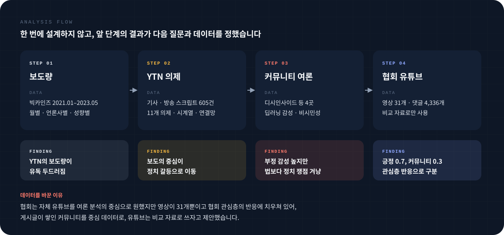
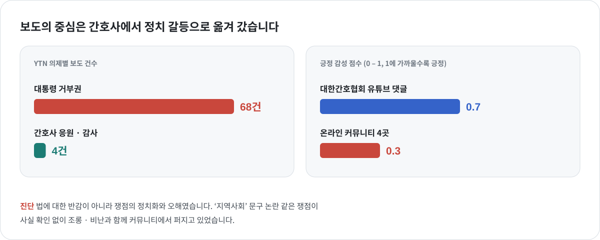
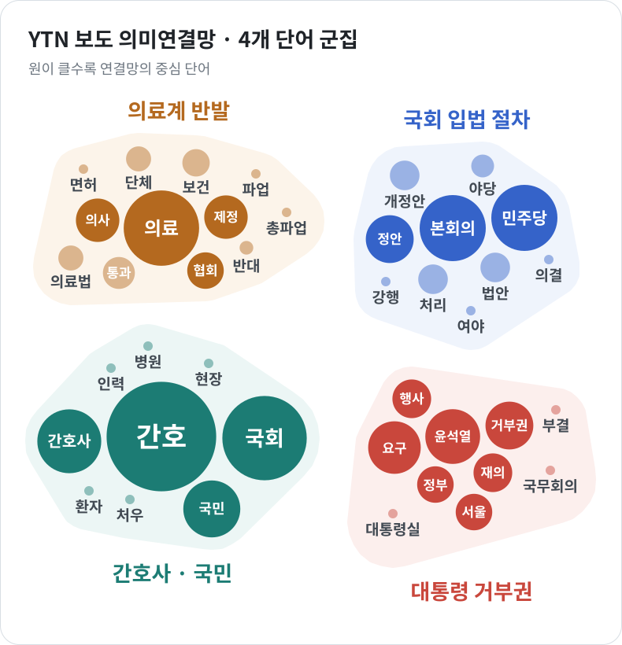

<a href="../README.md#featured-work">← Featured Work</a>

 

FEATURED 02 &nbsp;·&nbsp; 2023.06 – 2023.12 &nbsp;·&nbsp; 대한간호협회 의뢰 연구 &nbsp;·&nbsp; 분석 전담

# 간호법 관련 언론 보도와 온라인 여론

**언론은 간호법을 어떻게 보도했고, 온라인 이용자는 어떻게 반응했을까?**

  
  
   
  
  

| 항목 | 내용 |
|:--|:--|
| 보고서 | **2023 간호법 제정에 관한 국내 언론보도와 국민여론 분석** |
| 의뢰 | 대한간호협회 |
| 역할 | 보조연구원  · 데이터 수집 · 분석, 결과 기술, 발표 자료 초안 |
| 데이터 | 빅카인즈 보도 (2021.01 – 2023.05) · YTN 방송 스크립트 **605건** · 온라인 커뮤니티 4곳 게시글 · 협회 유튜브 댓글 **4,336개** |
| 공개 자료 | [언론 보도 데이터 (CSV)](../assets/data/medical_all.csv) &nbsp;·&nbsp; [유튜브 댓글 데이터 (CSV)](../assets/data/YTC.csv) &nbsp;·&nbsp; [커뮤니티 댓글 데이터 (CSV)](../assets/data/sentiment_analysis_result_fm.csv) &nbsp;·&nbsp; [변수 설명](../assets/data/README1.md) |

 

## 연구 문제

2023년 간호법 제정은 대통령 거부권 행사로까지 이어지며 큰 사회적 논쟁이 되었습니다. 대한간호협회는 이 과정에서 간호법에 대한 언론 보도와 국민 여론이 어떠한지 확인하고자 연구를 의뢰했습니다. 협회가 정해진 보고서 양식을 제공하지 않아, 여론을 조성하는 전체 언론 보도 데이터에서 출발해 앞 단계의 분석 결과에 맞게 새로운 데이터를 수집·분석하며 범위를 좁혀 가는 방식으로 설계했습니다.

| 구분 | 연구 질문 |
|:--|:--|
| **언론** | 간호법 관련 언론 보도는 어느 시기에 증가하였고, 어떤 의제를 중심으로 이루어졌으며, 언론사 성향에 따라 어떻게 달랐는가? |
| **온라인 이용자** | 온라인 이용자는 간호법에 대해 어떤 의견을 보였고, 어떤 어조로 글을 작성했으며, 채널에 따라 반응이 어떻게 달랐는가? |

 

## 분석 방법

- **보도량** — 빅카인즈에서 2021.01 – 2023.05 간호법 보도를 수집해 월별 · 언론사별 · 성향별(보수 3개지 · 진보 2개지)로 비교했습니다. 보도량이 가장 많았던 YTN을 의제 분석 대상으로 정했습니다.
- **언론 의제** — 보도가 급증한 2023.02 이후 YTN 기사 · 방송 스크립트 605건을 웹 스크레이핑으로 수집해 11개 의제로 분류하고, 연관어 분석 · LDA 토픽 모델링 · 의미연결망(매개 중심성)으로 의제 간 관계를 살폈습니다.
- **온라인 여론** — 이용자 규모를 기준으로 디시인사이드 · 에펨코리아 · 뽐뿌 · 일간베스트를 선정해 2023.03 – 05 간호법 게시글을 수집하고, 딥러닝 감성 분석과 비시민성(혐오 · 조롱 · 비방) 분석을 수행했습니다.
- **비교 자료** — 대한간호협회 공식 유튜브 채널의 영상 31개, 댓글 4,336개에 같은 분석을 적용해 커뮤니티와 비교했습니다.

 

## 결과 1 · 언론은 무엇을 보도했나

<table>
<tr>
<td width="42%" valign="top">

| YTN 주요 의제 | 보도 건수 |
|:--|--:|
| 대통령 거부권 | **68건** |
| 의사협회 등 단체 집회 · 파업 | 63건 |
| 간호법 찬성 / 반대 | 40건 / 26건 |
| 간호사 응원 · 감사 | **4건** |

</td>
<td width="58%">

</td>
</tr>
</table>
간호법 관련 보도는 2023년 3 – 5월에 급증했습니다. 그러나 보도량이 늘어난 만큼 간호사의 처우에 대한 관심이 늘지는 않았습니다. 팬데믹 시기 간호사의 역할을 조명하던 보도는 4건에 그쳤고, 보도의 중심은 대통령 거부권과 단체 간 대립 같은 정치 갈등으로 옮겨 갔습니다. 성향별로는 보수 언론이 간호법의 문제점과 사회적 비용에, 진보 언론이 간호법의 필요성에 더 주목했습니다.

 

## 결과 2 · 온라인 커뮤니티는 어떻게 반응했나

| 커뮤니티 | 간호법 게시글 (2023.03 – 05) |
|:--|--:|
| 디시인사이드 | 2,000건 이상 |
| 에펨코리아 | 500건 이상 |
| 뽐뿌 · 일간베스트 | 각 250건 이하 |

커뮤니티에서는 '거부권 행사', '면허 취소', '처우 개선' 같은 단어 조합이 자주 등장했고, 부정 감성과 비시민성이 높게 나타났습니다. 그러나 원문을 다시 읽어 보면 부정적 표현은 법 자체보다 정당과 관련 단체 같은 정치 쟁점을 겨냥한 경우가 많았습니다. '지역사회' 문구 논란처럼 사실 확인 없이 퍼진 쟁점도 확인했습니다. 문제는 법에 대한 반감이라기보다 **쟁점의 정치화와 오해**였습니다.

 

## 결과 3 · 채널마다 여론이 달랐나

| 채널 | 긍정 감성 (0 – 1) | 주된 반응 |
|:--|--:|:--|
| 협회 유튜브 댓글 | **0.7** | 간호사 응원 · 감사, 간호법 지지 |
| 온라인 커뮤니티 | 0.3 | 정치 쟁점을 둘러싼 비난 · 조롱 |

협회 유튜브 댓글은 커뮤니티보다 긍정 감성이 크게 높고 비시민성은 낮았습니다. 다만 협회 채널을 찾아온, 이미 관심을 가진 이용자의 반응이므로 이를 일반 여론으로 해석하지 않았습니다.

 

## 주요 의의

- **데이터의 대표성을 따져 분석 데이터를 변경했습니다.** 협회는 자체 유튜브 채널을 여론 분석의 중심으로 원했지만, 영상이 31개뿐이고 관심층의 반응에 치우쳐 있었습니다. 게시글이 쌓인 커뮤니티를 중심 데이터로, 유튜브는 비교 자료로 쓰자고 제안해 협회의 요청과 데이터의 대표성을 함께 살렸습니다.
- **분석 결과를 다시 확인했습니다.** 토픽 모델링으로 묶인 주제는 기사 원문과 대조한 뒤 이름을 정했고, 부정 감성이 높게 나온 게시글도 반대 여론으로 단정하지 않고 원문에서 표현이 무엇을 향하는지 확인했습니다.
- **분석을 다음 행동으로 연결했습니다.** 임원진 발표에서 "여론의 분위기를 바꾸려면 어떻게 해야 하느냐"는 질문을 받고, 간호법이 '간호사 이득만 챙기는 법'으로 비친다는 분석을 근거로 **지역 의료 인력 부족을 해결하는 법**으로 의제를 전환하자고 제안했습니다. 이후 협회가 간호법 홍보 방식을 바꿨다고 전해 들었습니다.

각 단계의 결과는 교수님과 검토해 다음 데이터와 분석 방법을 정했습니다. 보고서의 정책적 제언(정치 중립적 메시지 재구성, 쟁점별 팩트체크, 상시 미디어 모니터링)은 연구진이 작성했으며, 위 분석 결과가 그 근거가 되었습니다.

 

---

[← 이전: 부산 청년 실태보고서](anchor-busan-youth.md) &nbsp;·&nbsp; [Featured Work로 돌아가기](../README.md#featured-work) &nbsp;·&nbsp; [다음: 총선 후보 유튜브 →](politician-youtube-campaign.md)
