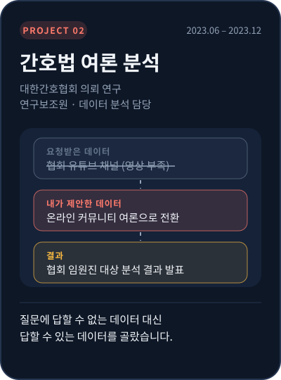

[← 포트폴리오로 돌아가기](../README.md)

# 📂 간호법 여론 분석

**질문에 답할 수 없는 데이터 대신, 답할 수 있는 데이터를 골랐습니다.**

간호법 제정 논쟁이 한창이던 2023년, 대한간호협회의 의뢰로 국내 언론과 온라인 여론이 간호법을 어떻게 다루는지 분석했습니다. 학부생 연구보조원으로 데이터 분석 전체를 맡았고, 분석 결과를 협회 임원진 앞에서 발표했습니다.

| 항목 | 내용 |
|:--|:--|
| 기간 | 2023.06 – 2023.12 (학부 재학 중) |
| 의뢰 | 대한간호협회 |
| 역할 | 연구보조원 · **데이터 수집·분석 전체, 분석 결과 작성, 발표 자료 초안** |
| 데이터 | 간호법 관련 뉴스 기사 + 온라인 커뮤니티 게시글 (직접 수집) |
| 방법 | 텍스트 분석으로 언론 프레이밍과 온라인 커뮤니티의 주요 담론 비교 |
| 결과물 | 「간호법 제정에 관한 언론 보도 및 여론 분석」 보고서 · 협회 임원진 대상 발표 |

 

---

## ① 문제 정의 — 요청받은 데이터로는 답이 나오지 않았다

협회는 처음에 **협회 유튜브 채널을 분석해 달라**고 요청했습니다. 그런데 데이터를 확인해 보니 채널의 영상 수가 너무 적어, 이것만으로는 "사람들이 간호법을 어떻게 보는가"라는 질문에 답할 수 없었습니다.

## ② 데이터 다시 고르기 — 새로 모으기

그래서 **온라인 커뮤니티 게시글을 주된 여론 데이터로 쓰자고 제안**했습니다. 커뮤니티는 사람들이 간호법에 대해 실제로 이야기를 나누는 곳이라, 협회 채널보다 여론을 더 잘 보여줄 수 있다고 판단했습니다.

> 요청 데이터 (협회 유튜브, 영상 부족) → **제안 데이터 (온라인 커뮤니티 여론)** → 분석 → 발표

## ③ 분석 — 합치기

뉴스 기사와 커뮤니티 게시글을 직접 수집해 텍스트로 분석했습니다. **언론이 간호법을 어떤 틀(프레임)로 보도하는지**와 **커뮤니티에서 사람들이 주로 어떤 이야기를 하는지**를 나란히 놓고 비교했습니다.

<!-- 그래프를 넣으려면 projects 폴더에 이미지를 올리고 아래 주석을 푸세요

-->

## ④ 발표 — 분석을 실행안으로 바꿔 말하기

협회 임원진 앞에서 분석 결과를 발표했습니다. 발표 중 "보도와 여론의 분위기를 바꾸려면 어떻게 해야 하느냐"는 질문을 받았고, 그 자리에서 **간호법을 '지역 의료 인력 부족을 해결하는 법'이라는 관점으로 다시 설명하고, 이를 보도자료와 협회 공식 SNS 채널로 알리자**고 제안했습니다.

## 내 역할

- 뉴스 기사·커뮤니티 게시글 **수집과 분석 전체**, 분석 결과 작성
- 주 여론 데이터를 유튜브에서 온라인 커뮤니티로 바꾸자는 **데이터 전환 제안**
- 초기 발표 자료 제작과 **협회 임원진 대상 발표**
- 문서 준비, 메일 소통 등 연구 실무

## 🛵 배달 현장에 적용한다면

- **요청받은 지표가 답을 주지 못하면, 대신 쓸 데이터를 먼저 제안하겠습니다.** 주어진 숫자만 돌리기보다 그 숫자로 현장 문제를 설명할 수 있는지부터 확인하겠습니다.
- **분석 결과를 듣는 사람이 바로 쓸 수 있는 말로 바꾸겠습니다.** 협력사와 유관부서가 "그래서 무엇을 하면 되는지" 알 수 있도록 실행안까지 함께 전하겠습니다.

 

[← 이전 프로젝트: 부산 청년 실태보고서](anchor-busan-youth.md) &nbsp;·&nbsp; [포트폴리오로 돌아가기](../README.md) &nbsp;·&nbsp; [다음 프로젝트: 차별 보도 법제 비교 →](press-arbitration.md)
