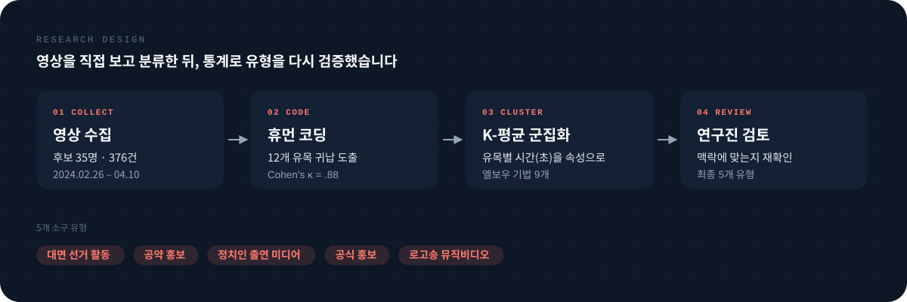
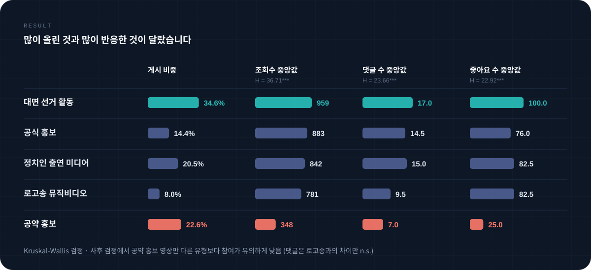
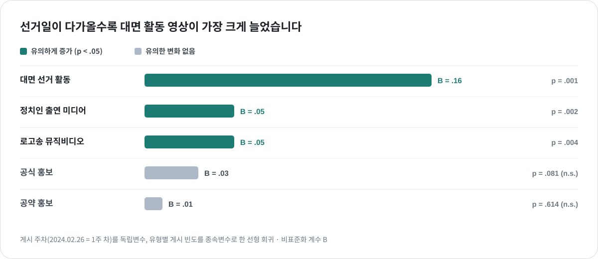

<a href="../README.md#featured-work">← Featured Work</a>

 

FEATURED 03 &nbsp;·&nbsp; 『사회과학연구』 32(4) &nbsp;·&nbsp; 2025 &nbsp;·&nbsp; 제1저자

# 정치인 유튜브 선거 콘텐츠와 이용자 참여

**후보들이 많이 올린 콘텐츠에 유권자도 반응했을까?**

  
  
   
  
  

| 항목 | 내용 |
|:--|:--|
| 논문 | **정치인 유튜브 선거 캠페인 콘텐츠의 소구와 이용자 참여** Appeal and User Engagement in Politicians’ YouTube Electoral Campaign Content |
| 학술지 | 『사회과학연구』 32(4), 동국대학교 사회과학연구원, 2025.12 &nbsp;·&nbsp; [DOI](https://doi.org/10.46415/jss.2025.12.32.4.537) &nbsp;·&nbsp; [원문](https://scholarworks.dongguk.edu/item/85f6d494-df5c-49c2-9de1-b49815e28ab9) |
| 저자 | **이윤승** (제1저자), 리시웨, 김범수 |
| 역할 | 연구 설계, 데이터 수집 · 코딩, 분석, 논문 작성, 학회 발표까지 전 과정 주도 |
| 데이터 | 제22대 총선 부산 지역 더불어민주당 · 국민의힘 후보 **35명**의 유튜브 롱폼 영상 **376건** (민주 215 · 국민의힘 161), 2024.02.26 – 04.10 |
| 공개 자료 | [코딩 데이터 (CSV)](../assets/data/time_content.csv) &nbsp;·&nbsp; [변수 설명](../assets/data/README.md) |

 

## 연구 질문

제22대 총선에서는 당선자의 75% 이상이 개인 유튜브 채널을 운영할 만큼, 유튜브가 선거 캠페인의 핵심 도구가 됐습니다. 그러나 방송 · 인쇄 광고와 달리 소셜미디어 홍보 콘텐츠는 어떤 메시지가 효과적인지에 대한 근거가 부족해, 효과가 검증되지 않은 콘텐츠가 대량으로 만들어지고 있습니다. 그래서 후보자들이 어떤 소구의 콘텐츠를 만들었는지, 그 콘텐츠가 실제로 이용자의 반응을 이끌었는지 검증했습니다.

| 구분 | 연구 질문 |
|:--|:--|
| **채널 운영자** | 후보자의 유튜브 콘텐츠는 어떤 소구 유형으로 구분되며, 정치 성향과 선거 시점에 따라 어떻게 달라지는가? |
| **이용자** | 소구 유형에 따라 조회수 · 댓글 수 · 좋아요 수는 어떻게 달라지는가? |

 

## 데이터 · 방법

- **수집** — 후보자 이름으로 공식 채널을 확인한 뒤, 선거 기간 게시된 영상의 제목, 게시일, 조회수 · 댓글 수 · 좋아요 수를 영상별로 수집했습니다.
- **코딩** — 376건을 모두 시청하며 12개 소구 유목을 귀납적으로 도출하고, 영상마다 각 유목이 재생 시간에서 차지한 비율을 1초 단위로 기록했습니다. 박사과정 수료생과 공동 코딩했으며, 표본의 10%(38건)로 측정한 코더 간 신뢰도는 Cohen’s κ = .88입니다.
- **군집화** — 한 영상에 여러 소구가 섞여 있어, 12개 유목의 시간 비율을 속성으로 K-평균 군집화를 수행해 소구 구성이 비슷한 영상끼리 묶었습니다.
- **검정** — 정당별 차이는 교차분석, 시점별 변화는 주차별 회귀로 확인했습니다. 참여 지표는 Kruskal-Wallis 검정과 Dunn 사후검정으로 유형 간 차이를 비교했습니다.

 

## 결과 1 · 후보자들은 어떤 콘텐츠를 많이 올렸나

| 유형 | 내용 | 전체 | 보수 | 진보 |
|:--|:--|--:|--:|--:|
| **대면 선거 활동** | 거리 유세 · 연설, 주민 소통, 행사 참여, 유세 현장 스케치 | **34.6%** | 31.1% | 37.2% |
| **공약 홍보** | 지역구 공약을 홍보하거나 설명하는 영상 | 22.6% | **29.8%** | 17.2% |
| **정치인 출연 미디어** | 토론회, 방송 · 다른 유튜브 출연, 인터뷰 발췌 | 20.5% | 17.4% | **22.8%** |
| **공식 홍보** | 캠프가 제작한 경력 · 인성 홍보 영상 | 14.4% | 11.8% | 16.3% |
| **로고송 뮤직비디오** | 유세 로고송을 뮤직비디오로 만든 영상 | 8.0% | 9.9% | 6.5% |

두 진영 모두 대면 선거 활동 영상을 가장 많이 올렸지만, 그다음 선택이 갈렸습니다. 보수 후보는 공약 홍보, 진보 후보는 방송 출연 장면을 발췌한 영상을 더 많이 올렸습니다 (χ² = 11.43, p < .05).

 

## 결과 2 · 유권자는 무엇에 반응했나

| 지표 | 전체 중앙값 | 검정 | 가장 높은 유형 | 가장 낮은 유형 |
|:--|--:|:--|:--|:--|
| 조회수 | 742회 | H = 36.71, p < .001 | 대면 선거 활동 959회 | 공약 홍보 348회 |
| 댓글 수 | 11.5개 | H = 23.66, p < .001 | 대면 선거 활동 17.0개 | 공약 홍보 7.0개 |
| 좋아요 수 | 73개 | H = 22.92, p < .001 | 대면 선거 활동 100개 | 공약 홍보 25개 |

공약 홍보 영상은 게시 비중 2위였지만, 조회수 중앙값은 대면 선거 활동 영상의 약 36%에 그쳤습니다. 사후검정에서도 공약 홍보 영상만 다른 유형과 유의하게 달랐습니다. 게시량으로는 주력 콘텐츠였지만, 반응으로는 가장 덜 통한 콘텐츠였습니다.

 

## 결과 3 · 선거가 다가올수록 무엇이 늘었나

선거일이 가까워질수록 대면 선거 활동 영상이 가장 크게 늘었고(B = .16), 공약 홍보 영상은 기간 내내 일정했습니다(B = .01, n.s.). 선거 직전에 정책 메시지가 강해진다는 국내 선행연구와 달리, 유튜브에서는 막판으로 갈수록 정책 정보보다 후보의 이미지와 현장감을 내세웠습니다.

 

## 핵심 판단 3가지

- **사람의 분류를 데이터로 다시 확인했습니다.** 학회 발표에서 휴먼 코딩이 주관적일 수 있다는 지적을 받고, 소구별 시간 비율로 K-평균 군집화를 더했습니다. 엘보우가 가리킨 9개를 그대로 쓰지 않고, 원본 영상과 대조해 해석 가능한 5개 유형으로 정했습니다.
- **평균보다 분포를 먼저 봤습니다.** 조회수 평균은 1,858회였지만 중앙값은 742회로 소수 영상에 크게 쏠려 있었습니다. 그래서 분산분석 대신 비모수 검정을 택했습니다.
- **게시량과 반응을 분리해 봤습니다.** 많이 만든 콘텐츠가 곧 잘 통한 콘텐츠는 아니었습니다. 같은 데이터를 공급(게시 비중)과 반응(참여 지표)으로 나눠 보자 둘 사이의 어긋남이 드러났습니다.

 

---

[← 이전: 간호법 언론 · 여론 분석](nursing-law.md) &nbsp;·&nbsp; [Featured Work로 돌아가기](../README.md#featured-work)
