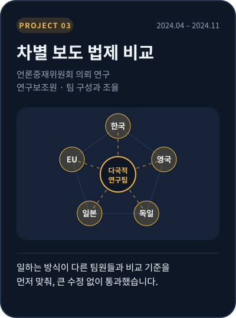

[← 포트폴리오로 돌아가기](../README.md)

# 📂 차별 보도 법제 비교

**일하는 방식이 다른 팀원들과 비교 기준을 먼저 맞췄습니다.**

언론중재위원회의 의뢰로 한국·영국·독일·일본·EU의 차별적 언론 보도 관련 법규범과 시정 권고 사례를 비교했습니다. 연구보조원이었지만 연구원 섭외와 팀 구성, 자료 수집과 방법 설계, 결과 작성을 위임받아 다국적 연구팀을 꾸리고 조율했습니다.

| 항목 | 내용 |
|:--|:--|
| 기간 | 2024.04 – 2024.11 |
| 의뢰 | 언론중재위원회 |
| 보고서 | 「차별적 언론 보도에 대한 법제 및 시정 방안 연구」 언론중재위원회 「2024년 해외언론법제연구 결과보고서」로 발간 |
| 역할 | 연구보조원 · **연구원 섭외와 팀 구성, 자료 수집·방법 설계, 한국·영국 파트, EU 법 조항 조사, 보고서 양식 초안** |
| 비교 대상 | 한국 · 영국 · 독일 · 일본 · EU |
| 협업 방식 | 독일·일본 연구원과 다국적 팀, 영어로 협업 |

 

---

## ① 문제 정의 — 원문을 읽을 사람이 없었다

각국의 법 조항과 실제 기사를 비교하려면 **원문을 직접 읽어야** 했습니다. 하지만 기존 연구진만으로는 독일어와 일본어 원문을 분석하기 어려웠습니다.

## ② 사람을 모으기 — 새로 모으기

필요한 역량을 가진 사람을 직접 찾아 나섰습니다.

| 파트 | 섭외 방법 |
|:--|:--|
| 일본 | 일본인 대학원 선배를 직접 섭외 |
| 독일 · EU | 유학생 센터를 통해 독일 출신 연구원을 모집 |
| 한국 · 영국 | 직접 담당 — 차별적 언론 보도 사례 발굴, 법·규제 체계 검토 |

## ③ 기준 맞추기 — 합치기

팀원마다 작업 방식이 달라서, 그대로 두면 **국가별 결과를 같은 기준으로 비교할 수 없게 될 위험**이 있었습니다.

- 모두가 같은 언어로 소통할 수 있도록 **영어로 협업**하자고 제안
- 결과가 다 모인 뒤에 맞추는 대신, **단계마다 중간 결과를 공유**하자고 제안
- **보고서 양식 초안을 먼저 만들어**, 모든 파트가 같은 틀에 맞춰 정리하도록 함

## ④ 결과

- **기한 안에 보고서 완성**
- 의뢰 기관 검토를 **큰 수정 없이 통과**
- 언론중재위원회 「2024년 해외언론법제연구 결과보고서」로 발간

## 내 역할

- 일본·독일 파트 연구원 섭외와 다국적 팀 구성
- 자료 수집 방법 설계, 보고서 양식 초안 작성
- 한국·영국 파트의 사례 발굴과 법·규제 체계 검토, EU 법 조항 조사
- 팀원 간 진행 방식 조율 (영어 소통, 단계별 중간 공유)

## 🛵 배달 현장에 적용한다면

- **"무엇을 같은 기준으로 볼지"부터 합의하겠습니다.** 협력사와 유관부서마다 보는 지표와 일하는 방식이 다르기 때문에, 실행안을 논의하기 전에 지표의 정의와 비교 기준을 먼저 맞추겠습니다.
- **필요한 사람은 직접 찾아가겠습니다.** 문제를 풀 정보를 가진 사람이 팀 밖에 있다면, 직접 찾아가 섭외하고 협업 구조를 만들겠습니다.

 

[← 이전 프로젝트: 간호법 여론 분석](nursing-law.md) &nbsp;·&nbsp; [포트폴리오로 돌아가기](../README.md)
